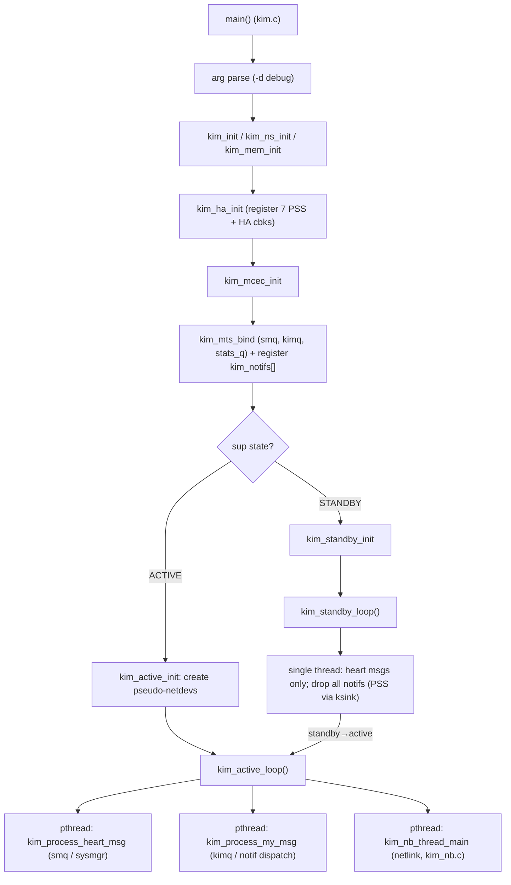
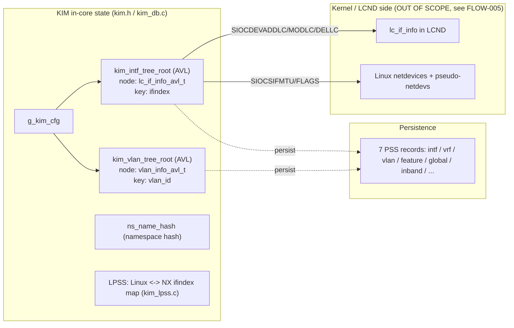
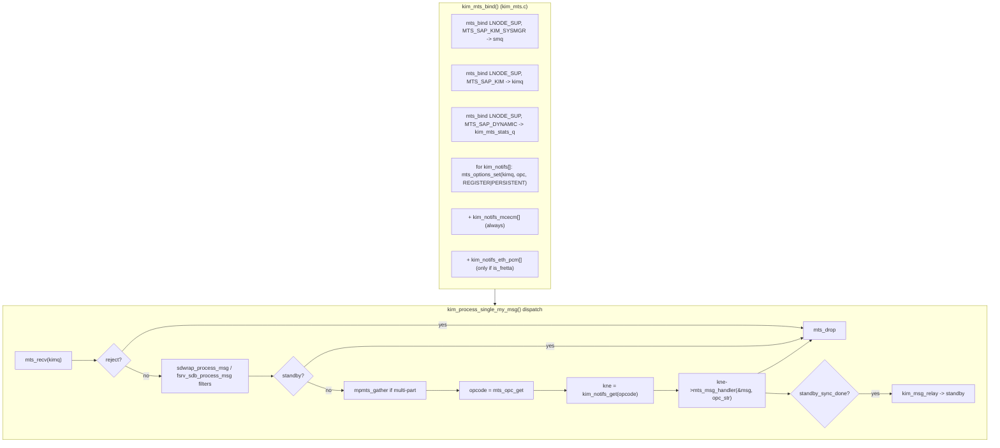
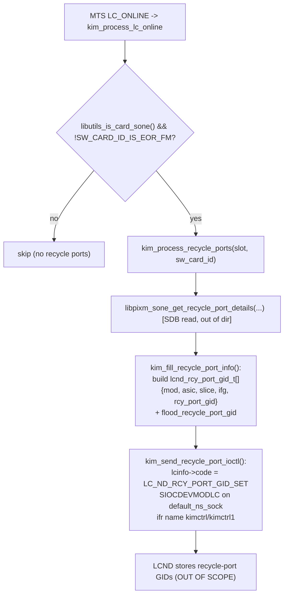

# KIM (Kernel Interface Manager) Process Architecture

Userspace **supervisor daemon** that owns the NX-OS ↔ Linux-kernel interface
contract for the kstack datapath. This document describes the **KIM process**
(`standalone/infra/kstack/kim/`): what it does, the data structures it owns, the
**MTS notification → handler → kernel/LCND-program** call sequences, who programs
KIM's structures, and the platform (PID) matrix with a deep focus on Silicon One.

> **Scope & boundary.** Everything under `standalone/infra/kstack/kim/` is
> **in scope**. KIM is a *control-plane translator*: it consumes MTS notifications
> from the NX-OS component mesh and **programs the kernel and LCND** (via `ioctl`
> on netdevices) so the Linux side of the box matches NX-OS interface/VLAN/VRF
> state. The **LCND kernel module** (which reads what KIM writes and does the
> actual decap/encap/hash-table work) is **out of scope here** — see
> `references/kim-mts-map.md` (FLOW-005) for the LCND-side programming verbs, and
> `architecture/psinb-driver-architecture.md` / `klm-vdc-driver-architecture.md`
> for the punt/inject datapath. Out-of-dir MTS *producers* (ethpm, pcm, im,
> vlan_mgr, l3vm, eltm, nve, pixm, mcecm, ipfib) are cataloged as boundaries in §9.
>
> **Volatile vs stable.** MTS opcode *numbers*, PSS layout versions, card-index
> membership, and line numbers drift across releases/PIDs. Anchor on **function
> names**, **MTS opcode symbols** (`MTS_OPC_*`), the **`LC_ND_*` ioctl verbs**, the
> **`SIOCDEV*LC` ioctl families**, and trace-string literals. Source read
> 2026-07-10, image `space_kkomarag_COV_10_7_0_IMG9_0_201`.

---

## 1. Purpose

KIM answers one question continuously: **"given the current NX-OS interface /
VLAN / VRF / feature state, what must the Linux kernel and LCND be told so their
netdevices and forwarding metadata match?"**

- It **binds MTS** service access points, **registers** for ~40 notification
  opcodes, and runs a receive loop that dispatches each opcode to a handler.
- Each handler mutates KIM's **in-core databases** (two AVL trees + a namespace
  hash + the Linux↔NX index map) and then **pushes** the delta into the kernel /
  LCND through `ioctl` on control netdevices (`kimctrl`, `default_ns_sock`, per-if
  sockets) using the `SIOCDEVADDLC` / `SIOCDEVMODLC` / `SIOCDEVDELLC` /
  `SIOCSIFMTU` / `SIOCSIFFLAGS` verbs.
- It **persists** everything it programs into **PSS** (Persistent Storage Service)
  so a stateful restart / ISSU / supervisor switchover can be replayed without
  disturbing the datapath.
- It **manufactures pseudo-netdevices** (diag, sup-eth, sflow, netflow, ssx,
  telemetry drop/delay/ipt, pmn, mti) that the rest of the stack punts/injects on.

So KIM is the **interface-state compiler**: NX-OS component events in, kernel +
LCND netdevice programming out, with a PSS journal on the side. It does **not**
forward packets, does **not** decap/encap, and does **not** own the datapath hash
tables — it *populates* the `lc_if_info` those tables are built from.

---

## 2. Module identity & build

| Item | Value |
|------|-------|
| Daemon | `kim.bin` (userspace, run under **sysmgr**) |
| Control util | `kimctrl.bin` (thin ioctl/debug companion binary) |
| Show/CLI lib | `libkimcli.so` (from `kim.cli`, backs `show` commands) |
| Shared lib | `libkim.so` (`lib/` subdir — shared helpers) |
| sysmgr config | `kim.conf` (service definition, HA policy, rlimits) |
| Scope | **infra** (`standalone/infra/kstack/kim/`) |

**Object inventory** (translation units → responsibility):

| Object | Responsibility |
|--------|----------------|
| `kim.o` (`kim.c`) | `main()`, init sequence, active/standby loops, pseudo-netdev factory, HA recovery |
| `kim_mts.o` (`kim_mts.c`) | MTS bind/register, notifs tables, receive/dispatch loop, ~40 handlers, MTS senders |
| `kim_msg_handler.o` | Interface create/delete/modify workers invoked by handlers (large file) |
| `kim_db.o` (`kim_db.c`) | The AVL databases (`kim_intf_tree_root`, `kim_vlan_tree_root`) add/find/del |
| `kim_pss.o` (`kim_pss.c`) | PSS write/read for all 7 record types (interface/vrf/vlan/feature/global/inband/…) |
| `kim_lpss.o` (`kim_lpss.c`) | Linux ↔ NX-OS ifindex mapping (LPSS) |
| `kim_sysmgr.o` | sysmgr handshake, sup-state transitions, ISSU handshake |
| `kim_mcec.o` (`kim_mcec.c`) | MCEC / vPC peer DB handling (`kim_process_mcec`) |
| `kim_nb.o` (`kim_nb.c`) | Netlink non-blocking thread (namespace / kernel netlink events) |
| `kim_ethtool.o` | ethtool-style queries on netdevices |
| `kim_msgs.o`, `kim_debug.o` | MTS message encode/decode helpers; debug/trace plumbing |
| `kim_tor.o` (`kim_tor.c`) | **Dead code** — entire file is `#if 0`. SONE ToR logic lives in `libutils_vchassis_tor*` + `container_id` checks in `kim.c`/`kim_mts.c`, **not** here. |

**Build (two views):**

- **Bazel (current).** `BUILD` defines `kim_conf`, `kim.cli`, `libkimcli.so`,
  `kimctrl.bin`, and `kim.bin` with `isan` + `routing-sw` include trees and the
  `KIM_MULTI_THREADED_PSS` define on supervisor platforms.
- **gmake (legacy).** `module.mk` builds `kim.bin` + `kimctrl.bin`; adds
  `-DKIM_MULTI_THREADED_PSS` when `BLDGRP == supe`.

**sysmgr / HA policy (`kim.conf`):** stateful restart; `MALLOC_ARENA_MAX=2`;
per-sup and dual-sup `minlife`/`maxretry`; **`standby_mode = sync`** and
**`global_sync = yes`** for dual-supervisor — i.e. KIM keeps the standby warm by
PSS sync, not by replaying MTS on the standby (see §3, §11).

---

## 3. Process lifecycle & threading



**Active supervisor** runs **three pthreads** (`kim_active_loop`):

1. `kim_process_heart_msg` — services **`smq`** (`MTS_SAP_KIM_SYSMGR`): sysmgr
   heartbeat + supstate transitions.
2. `kim_process_my_msg` — services **`kimq`** (`MTS_SAP_KIM`): the main
   notification dispatch loop (§5).
3. `kim_nb_thread_main` — the netlink non-blocking thread (namespace / kernel
   events, `kim_nb.c`).

`kim_active_loop` `pthread_join`s all three (never returns in steady state).

**Standby supervisor** runs `kim_standby_loop` — a **single** thread that only
processes heartbeat messages and **drops all notifications** (the dispatch loop
hits `if (my_sup_state == SYSMGR_SUPSTATE_STANDBY) goto done;`). Standby state is
kept current by **PSS sync via ksink**, not by MTS replay. On `standby → active`
it returns and `kim_active_loop` takes over.

**Restart flavors:** cold start vs stateful-restart vs ISSU vs switchover all
funnel through the HA/PSS recovery path (§11); `is_upgrade_restart` and
`kim_issu_clients_handshaked` gate the ISSU handshake.

---

## 4. Key data structures (what KIM owns)



- **`g_kim_cfg`** (global config, `kim.h`) — the root, holding both AVL trees plus
  interface counters/flags.
- **`kim_intf_tree_root`** — AVL of **`lc_if_info_avl_t`** nodes keyed by
  `ifindex`. Each node carries the `kim_pss_intf_data_t` (the LCND-relevant
  interface descriptor: iod, tunnel info, VRF, flags, MTU, MAC, dmod/dport,
  namespace) that gets both **persisted to PSS** and **programmed into LCND**.
- **`kim_vlan_tree_root`** — AVL of **`vlan_info_avl_t`** nodes keyed by VLAN id
  (VNI mapping, BD, reserved-VLAN membership, PVLAN association).
- **`ns_name_hash`** — network-namespace registry (name → ns state), initialized
  in `kim_ns_init` alongside the default netlink sockets and `RLIMIT_NOFILE`.
- **LPSS** (`kim_lpss.c`) — the **Linux ↔ NX-OS ifindex** translation used
  whenever KIM crosses the kernel boundary (a Linux `if_nametoindex` result vs an
  NX-OS `if_index_t`).
- **PSS (7 records)** — `kim_ha_init` registers interface, VRF, VLAN, feature,
  global, inband (+ more) PSS record types with the HA library, with snapshot /
  switchover / recovery callbacks.

---

## 5. MTS architecture — bind, register, dispatch, send



**Queues.** Three MTS binds, all `LNODE_SUP`, `uuid = SRVUUID_KIM`, `PERSISTENT`:
`smq` (`MTS_SAP_KIM_SYSMGR`), `kimq` (`MTS_SAP_KIM`, the workhorse),
`kim_mts_stats_q` (`MTS_SAP_DYNAMIC`, stats). All are `mts_recv_q_unblock`ed.

**Registration.** `kim_mts_bind` walks `kim_notifs[]` calling
`mts_options_set(kimq, opc, MTS_OPTION_REGISTER | MTS_OPTION_PERSISTENT)`.
`kim_mts_bind_mcecm()` always registers `kim_notifs_mcecm[]`;
`kim_mts_bind_eth_pcm()` registers `kim_notifs_eth_pcm[]` **only on Fretta**
(`is_fretta`).

**Lookup.** `kim_notifs_get(opc)` searches `kim_notifs[]`, then
`kim_notifs_mcecm[]`, then (Fretta only) `kim_notifs_eth_pcm[]`.

**Dispatch.** `kim_process_single_my_msg` → `mts_recv(kimq)` → drop rejects →
`sdwrap_process_msg` / `fsrv_sdb_process_msg` library filters → **standby short
-circuit** → `mpmts_gather` (multi-part) → `kim_notifs_get` → **handler** → if
`standby_sync_done`, **`kim_msg_relay`** forwards the raw msg to standby → `mts_drop`.

### 5.1 Notification catalog (`kim_notifs[]`, subscribed opcodes)

| Domain | MTS opcodes → handler |
|--------|-----------------------|
| **Interface life-cycle** | `IM_IF_CREATED`→`kim_process_if_created`; `IM_IF_REMOVED`→`kim_process_if_removed`; `KIM_CREATE_NETDEV`→`kim_process_if_create_netdev_req`; `IM_NVE_IF_REMOVED`→`kim_process_nve_delete_req` |
| **Port/link state** | `IM_PHY_LINK_STATE_CHANGE`→`kim_process_phy_state_change`; `IM_L2_PROTOCOL_STATE_CHANGE`→`kim_process_l2_state_change`; `IM_L3_PROTOCOL_STATE_CHANGE`→`kim_process_l3_state_change`; `IM_PORT_L2/L3_PARAM_CHANGE`→`kim_process_port_param_change`; `KIM_NETDEV_STATE_CHG[_NOTIFY]`→`kim_process_netdev_state_change`; `PM_PORT_BRINGUP`→`kim_process_port_bringup` |
| **Port-channel / bundle** | `PCM_INTERFACE_CHANGED`→`kim_process_pcm_change`; `PCM_FOP_CHANGED`→`kim_process_fop_update`; `PCM_SDB_PCINFO_UPDATE_BUNDLE_PORT`→`kim_process_pcm_sdb_update_bundle_port` (Fretta) |
| **VRF** | `L3VM`→`kim_process_vrf_update`; `L3VM_VRF_VNI_CHANGE`→`kim_process_l3vm_vrf_vni_change` |
| **VLAN / BD** | `VLAN_MGR_SDB_UPDATE_NOTIF`→`kim_handle_vlan_mgr_sdb_update`; `VLAN_MGR_VLAN_DELETED`→`kim_process_vlan_del_notif`; `VLAN_MGR_VLAN_ATTR_CHG_TO_KIM`→`kim_process_vlan_vni_change`; `VLAN_MGR_REQ_RSP_VLAN_CREATE`→`kim_process_vlan_create_req`; `PVLAN_ASSOCIATION_UPDATE`→`kim_process_pvlan_update`; `ELTM_VLAN_VNI_CHANGE`→`kim_process_eltm_vlan_sdb_change`; `ELTM_VLAN_BD_NOTIFY`→`kim_process_eltm_bd_change` |
| **VXLAN / NVE / VNI** | `KIM_GRE_TUN_UPD`→`kim_process_if_tun_upd`; `KIM_VPL_INFO_UPDATE`→`kim_handle_vpl_update`; `NVE_PD_IF_MSG`→`kim_process_nve_pd_if_msg`; `NVE_L3_VNI_NOTIFY`→`kim_handle_local_l3_vni_notif`; `HMM`→`kim_handle_hmm_notif` |
| **VNTAG / VETH / VIF** | `VETHMGR_ADD/DEL_VIF_MEMBER`→`kim_process_add/del_vif_member`; `VNTAG_VIF_CHANGE_MSG`→`kim_handle_vntag_vif_update`; `KIM_VNTAG_DVIF_UPD`→`kim_handle_vntag_vlan_dvif_update` |
| **Telemetry / netflow / CBL** | `KIM_NETFLOW_DP_INTF_UPDATE`→`kim_process_netflow_dp_intf_update`; `KIM_CBL_UPDATE`→`kim_process_cbl_update`; `KIM_FEX_CBL_UPDATE`→`kim_process_fex_cbl_update`; `KIM_DROP_NOTIFY_EN`→`kim_process_kim_drop_notify_en` |
| **Linecard / chassis** | `LC_ONLINE`→`kim_process_lc_online`; `LC_OFFLINE`→`kim_process_lc_removed`; `IM_SAT_FABRIC_PC_PORT_STATE_CHANGE`→`kim_process_sat_fabric_pc_port_state_change`; `VDC_ONLINE`→`kim_handle_vdc_online` |
| **Feature / misc** | `FM_SRV_FEATURE_STATUS`→`kim_handle_fm_status_msg`; `ETHPM_GLOBAL_PARAM_CHANGE`→`kim_process_dme_tag_native`; `PM_CMI_VLAN_DOT1Q_TAG_NATIVE`→`kim_handle_dot1_tag_native_vlan`; `VSH_ACFG_GEN`→`kim_process_ascii_gen_msg`; `KIM_INBAND_PPS_SET/GET`→`kim_process_inband_pps_set/get` |
| **MCEC (separate table)** | `MCECM_APP_LIB_DB_UPD`→`kim_process_mcec` |

### 5.2 KIM as an MTS **sender**

| Sender fn | Opcode → destination | Purpose |
|-----------|----------------------|---------|
| `kim_send_msg_to_ipfib` | `MTS_OPC_KIM_DOWNLOAD_ADJ` → `MTS_SAP_REGISTRY` | Ask ipfib/ufib to (re)download adjacency for an ifindex |
| vlan-create response | `vlan_create_seq_rsp_t` (reply) | Acknowledge `VLAN_MGR_REQ_RSP_VLAN_CREATE` request |
| ISSU restore-done | `KIM_STATEFUL_RSTRT` / `KIM_L3_STATEFUL_RSTRT` → registry | Signal end of stateful restore to clients |

---

## 6. Who programs the KIM data structures (deep chain)

The **only writers** of `g_kim_cfg`'s trees are KIM's own MTS handlers (the
standby never writes — it PSS-syncs). The canonical create chain:

```
MTS: IM_IF_CREATED / KIM_CREATE_NETDEV
  -> kim_process_if_created / kim_process_if_create_netdev_req   (kim_mts.c)
     -> kim_create_if(...)                                       (kim_msg_handler.c)
        -> kim_intf_add(ifindex) -> AVL insert into kim_intf_tree_root   (kim_db.c)
        -> kim_lpss_* : map Linux ifindex <-> NX if_index_t              (kim_lpss.c)
        -> fill lc_if_info {iod, mtu, mac, vrf, dmod/dport, ns, flags}
        -> os_syscall_ioctl(sock, SIOCDEVADDLC, &ifr)  -> LCND lc_if_info  (see FLOW-005)
        -> kim_pss_intf_info(...) : journal to interface PSS               (kim_pss.c)
```

The **modify** and **delete** chains mirror this:

- **Modify** (`kim_process_port_param_change`, `kim_process_phy/l2/l3_state_change`,
  `kim_process_vrf_update`, `kim_process_netdev_state_change`) →
  `kim_intf_find(ifindex)` → mutate node → `SIOCDEVMODLC` (and/or `SIOCSIFMTU`,
  `SIOCSIFFLAGS`) → re-journal PSS.
- **Delete** (`kim_process_if_removed`, `kim_process_nve_delete_req`) →
  `kim_intf_find` → `SIOCDEVDELLC` → `kim_intf_del` (AVL remove) → PSS delete.
- **VLAN** (`kim_process_vlan_create_req`, `kim_process_vlan_vni_change`,
  `kim_handle_vlan_mgr_sdb_update`) → `kim_vlan_*` on `kim_vlan_tree_root` → LCND
  VLAN/reserved-VLAN verbs (`LC_ND_RSVD_VLAN_BMP`, `LC_ND_RSVD_PER_PORT_VLAN_BMP`)
  → PSS.

**Key invariant:** *AVL write and LCND ioctl and PSS journal happen together* per
event. A crash between them is reconciled at restart by replaying PSS against the
kernel/LCND (§11). The **downstream LCND field programming** (which hash table,
which `lc_if_info` field) is documented in **FLOW-005** and is not repeated here.

---

## 7. Pseudo-netdevice factory (`kim.c`, active init only)

On becoming active, KIM manufactures pseudo-netdevices by filling an `lc_if_info`
and issuing `SIOCDEVADDLC` on `default_ns_sock` (ifr name `kimctrl` /`kimctrl1`
per `container_id`):

| Fn | Netdev | Gate |
|----|--------|------|
| `kim_create_psuedo_diag_nd` | `ps-diag` | always |
| `kim_create_psuedo_sup_eth1_nd` | `ps-sup-eth1` | always |
| `kim_create_psuedo_sflow_nd` | `sflow` | always |
| `kim_create_netflow_datapath_interface_nd` | `netflow-intf` | always |
| `kim_create_ssx_datapath_interface_nd` | `ssx-intf` | always |
| `kim_create_tele_drop_interface_nd` | `tele-drop` | `libutils_is_card_innovium()` |
| `kim_create_tele_delay_interface_nd` | `tele-delay` | `libutils_is_card_innovium()` |
| `kim_create_tele_ipt_interface_nd` | `tele-ipt` | `libutils_is_card_innovium() \|\| libutils_is_card_sone_gr2()` (G200) |
| (pmn / mti) | `pmn`, `mti` | platform-gated |

---

## 8. PID / platform matrix (deep Silicon One)

**KIM is mostly platform-independent** — the per-PID ASIC decode lives in LCND /
`klm_vdc`, not KIM. KIM's platform branches are **coarse capability gates**, not
per-family switch statements:

| Gate (function/macro) | Meaning | KIM behavior it toggles |
|-----------------------|---------|-------------------------|
| `is_fretta` | Fretta (Broadcom EOR) family | Registers `kim_notifs_eth_pcm[]` (bundle-port PCM SDB) |
| `libutils_is_card_sone()` | **any Silicon One card** | Recycle-port GID programming; mirror-GID programming; MCT reserved-VLAN (`g_kim_vxlan_mct_rsvd_vlan`) |
| `libutils_is_card_sone_gr2()` | **G200 (GR2)** SONE | `tele-ipt` pseudo-netdev creation |
| `libutils_is_card_innovium()` | Innovium (Ins) | `tele-drop` / `tele-delay` / `tele-ipt` pseudo-netdevs |
| `SW_CARD_ID_IS_EOR_FM(...)` | EOR fabric-module card | **Skips** recycle-port programming (no recycle ports on FM) |
| `container_id` | LXC / vchassis-ToR container instance | Selects ioctl netdev name `kimctrl` vs `kimctrl1` |

### 8.1 Silicon One PID families (as they matter to KIM)

| PID / codename | KIM-visible treatment |
|----------------|------------------------|
| **Krypton (KR)** — DPU/ToR | `libutils_is_card_sone()` path; ToR/container specifics via `container_id` + `libutils_vchassis_tor*` (NOT `kim_tor.c`, which is dead) |
| **Gibraltar (GB)** | `libutils_is_card_sone()` path; recycle/mirror/MCT common SONE code |
| **Palladium2 (P200)** | `libutils_is_card_sone()` path |
| **G200 (GR2)** | SONE common **plus** `libutils_is_card_sone_gr2()` → `tele-ipt` netdev |
| **G2LL** | `libutils_is_card_sone()` path |

> The **fine-grained per-PID `enum la_event_e` decode** (Krypton/GR2/P200/GB/G2LL
> header-gen) is a **klm_vdc / LCND** concern (see `klm-vdc-driver-architecture.md`
> §7.5), **not** KIM. KIM treats SONE largely as one family via
> `libutils_is_card_sone()`, with GR2 the only per-family special-case.

### 8.2 Deep SONE chain — recycle-port GID programming

The most SONE-specific programming KIM does, triggered by `LC_ONLINE`:



Companion SONE paths on the same trigger family:

- **Mirror GID** — `kim_program_mirror_gid(mod_num, sw_card_id, …)` on
  `LC_ONLINE` (program) and `LC_OFFLINE` (`kim_process_lc_removed`, clear).
- **MCT reserved VLAN** — in `kim_handle_vlan_mgr_sdb_update`, when
  `libutils_is_card_sone() && !g_kim_vxlan_mct_rsvd_vlan`, KIM picks
  `g_kim_vxlan_mct_rsvd_vlan` from the non-allocated reserved bitmap at
  `INSEOR_VXLAN_MCT_ENCAP_VLAN_OFFSET` and calls `kim_prgm_mct_rsvd_vlan()` (the
  outer tag for double-tagged BUM traffic over MCT for VXLAN VLANs).
- **Reserved-VLAN bitmaps** — `kim_process_rsvd_vlan(..., LC_ND_RSVD_VLAN_BMP)`
  and `LC_ND_RSVD_PER_PORT_VLAN_BMP` (platform-common, but consumed by SONE MCT).

---

## 9. External interactions / boundaries (out of scope, but named)

| Boundary | Direction | Interface |
|----------|-----------|-----------|
| **LCND** (kernel module) | KIM → kernel | `ioctl` `SIOCDEVADDLC/MODLC/DELLC`, `SIOCSIFMTU/FLAGS`, `LC_ND_*` verbs (FLOW-005) |
| **im / ethpm / pcm** | → KIM | MTS `IM_*`, `PCM_*`, `ETHPM_*` producers |
| **vlan_mgr** | ↔ KIM | MTS `VLAN_MGR_*` (incl. request/response vlan-create); SDB reads |
| **eltm** | → KIM | MTS `ELTM_VLAN_*` (BD / VNI) |
| **l3vm** | → KIM | MTS `L3VM*` (VRF, VRF-VNI) |
| **nve / hmm** | → KIM | MTS `NVE_*`, `HMM`, `KIM_GRE_TUN_UPD`, `KIM_VPL_INFO_UPDATE` |
| **pixm (libpixm)** | KIM → | `libpixm_sone_get_recycle_port_details`, dvp/dvif SDB helpers |
| **mcecm** | → KIM | MTS `MCECM_APP_LIB_DB_UPD` (→ `kim_mcec.c`) |
| **ipfib / ufib** | KIM → | MTS `KIM_DOWNLOAD_ADJ` to `MTS_SAP_REGISTRY` |
| **sysmgr** | ↔ KIM | service lifecycle, supstate, ISSU handshake (`smq`) |
| **PSS / HA lib** | KIM ↔ | 7 PSS record types + snapshot/switchover/recovery cbks |
| **kernel netlink** | ↔ KIM | `kim_nb.c` namespace / kernel events (`default_ns_sock`) |

---

## 10. Concurrency & locking

- **Active** = 3 pthreads (`heart`, `my`, `nb`) that share `g_kim_cfg` and the PSS
  layer; the build defines **`KIM_MULTI_THREADED_PSS`** on supervisors, i.e. PSS
  access is expected from multiple threads.
- **Standby** = single thread; no tree writes (PSS-sync only).
- **`kim_msg_relay`** runs on the dispatch thread only after `standby_sync_done`.
- ⚠️ *As-of note (needs-verify):* the specific mutex(es) guarding `g_kim_cfg` AVL
  trees across the `my`/`nb` threads were **not traced in this pass** — treat the
  lock discipline as a follow-up (grep `kim_db.c` / `kim.h` for the tree
  lock/`pthread_mutex`). Stated as observation, not asserted as safe.

---

## 11. HA / ISSU / PSS restore

- `kim_ha_init` registers **7 PSS record types** with snapshot / switchover /
  recovery callbacks and installs the HA policy from `kim.conf`
  (`standby_mode=sync`, `global_sync=yes`).
- **Stateful restart / switchover:** KIM replays PSS to rebuild `g_kim_cfg` and
  re-assert kernel/LCND state **without** tearing down the datapath.
- **ISSU:** `is_upgrade_restart` + `kim_issu_clients_handshaked` gate the client
  handshake; on completion KIM emits the `KIM_STATEFUL_RSTRT` /
  `KIM_L3_STATEFUL_RSTRT` restore-done notifications (§5.2).
- **Standby warmth** is maintained by PSS sync via **ksink**, which is why the
  standby dispatch loop drops MTS notifications rather than re-programming.

---

## 12. Architecture Decision Records (ADR)

**ADR-001 — MTS notification bus, not polling.** KIM subscribes to ~40 opcodes and
reacts to deltas. *Rationale:* interface/VLAN/VRF state is event-driven across many
producers (im/ethpm/pcm/vlan_mgr/l3vm/eltm/nve); polling would be O(N·rate) and
racy. *Trade-off:* correctness depends on producers emitting every delta; a missed
opcode = silent kernel/LCND drift. *Mitigation:* PSS journal + restart replay.

**ADR-002 — Twin AVL trees keyed by ifindex / vlan-id.** *Rationale:* O(log n)
lookup on the hot modify/delete path where events reference an interface or VLAN by
index. *Trade-off:* two structures to keep coherent with PSS and LCND; chosen over
a flat array (sparse index space) or hash (ordered iteration needed for snapshot).

**ADR-003 — Write-through: AVL + ioctl + PSS per event.** Each handler mutates the
tree, programs LCND/kernel via `ioctl`, and journals PSS in one logical step.
*Rationale:* keeps the three views convergent so restart can reconcile. *Trade-off:*
higher per-event cost and a small non-atomic window; accepted because PSS replay at
restart is the backstop.

**ADR-004 — Standby is PSS-synced, not MTS-replayed.** The standby drops
notifications and relies on ksink PSS sync (`standby_mode=sync`). *Rationale:*
avoids double-processing and keeps standby cheap/deterministic. *Trade-off:* the
active must relay (`kim_msg_relay`) only post-`standby_sync_done`; a sync gap during
switchover is closed by full PSS recovery.

**ADR-005 — Three-thread active model.** Separate threads for sysmgr heartbeat,
notification dispatch, and netlink. *Rationale:* heartbeat must never be starved by
a slow notification handler (sysmgr would kill KIM); netlink is independently
paced. *Trade-off:* shared-state locking burden (§10) and `KIM_MULTI_THREADED_PSS`.

**ADR-006 — Coarse platform gates, per-PID decode delegated to LCND/klm_vdc.** KIM
uses `libutils_is_card_sone()` / `is_fretta` / `is_card_innovium()` capability
checks rather than per-ASIC switch statements. *Rationale:* KIM programs
*descriptors* (`lc_if_info`, GIDs, reserved VLANs); the ASIC-specific *interpretation*
belongs in the datapath layer. *Trade-off:* GR2 still needs one special-case
(`tele-ipt`), and recycle-port/mirror-GID detail is genuinely SONE-only.

**ADR-007 — `kim_tor.c` retained as dead `#if 0`.** SONE ToR behavior is expressed
through `libutils_vchassis_tor*` + `container_id`, not a ToR TU. *Rationale:* avoids
a parallel code path; container-name selection (`kimctrl`/`kimctrl1`) is the only
ToR-visible branch. *Trade-off:* the dead file is a discoverability trap — documented
here so future readers don't mine it.

**ADR-008 — Recycle-port GIDs sourced from pixm SDB, pushed via `SIOCDEVMODLC`.**
KIM reads `libpixm_sone_get_recycle_port_details` and programs
`LC_ND_RCY_PORT_GID_SET`. *Rationale:* pixm owns port topology; KIM owns the
kernel/LCND contract. *Trade-off:* cross-component ordering (KIM must run
recycle-port programming on `LC_ONLINE` after pixm SDB is populated); EOR FM cards
are explicitly skipped.

---

## 13. Cross-reference

- **FLOW-005** (`references/kim-mts-map.md`) — the LCND-side programming verbs and
  per-opcode field transformations (the "what LCND does with what KIM wrote").
- **`psinb-driver-architecture.md`** — the `ps-inb` / `mgmt_dev` punt/inject
  datapath KIM's pseudo-netdevs feed.
- **`klm-vdc-driver-architecture.md`** — per-PID `la_event` / VDC ethertype decode
  that KIM deliberately does *not* do.
- **FLOW-006** — SONE codename ↔ PID reference.

> As-of hints in this doc (thread count, opcode set, 7 PSS records, SONE gates)
> are from a 2026-07-10 read of image `space_kkomarag_COV_10_7_0_IMG9_0_201`.
> Anchor on function names and `MTS_OPC_*` / `LC_ND_*` symbols; re-verify line-level
> detail per release.
