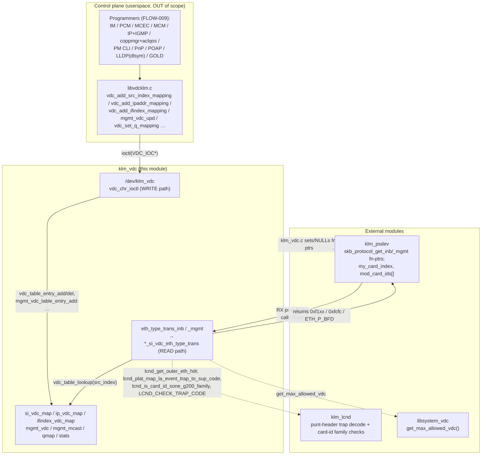

# `klm_vdc` Driver Architecture

Kernel-space **VDC (Virtual Device Context) queue/ethertype-classification** driver
for the NXOS supervisor inband + management punt paths. This document describes the
`klm_vdc` module
(`standalone/platform/storage/sup/kspace/vdc/`), centered on how it maps a punted
frame to an **NX-internal VDC queue ethertype** (the `0xf1xx` / `0xfcfc` family) that
LCND/kstack then uses to steer the frame to the right VDC and CPU queue.

> **Scope & platform.** This document is **Silicon One (SONE)-focused** for the
> inband datapath (`sone_si_vdc_eth_type_trans`, §7). The driver ALSO carries
> per-ASIC-family classifier variants (Tahoe/Innovium/BFN-Tofino/MTC/Nvidia/Titan
> and the Broadcom `INS_EOR` Jericho/Trident path) — these are **cataloged, not
> detailed** here (§6). The management/IPS classifiers (§8) are platform-common.
>
> **Volatile vs stable.** `CARD_INDEX_*` membership, `src_index`/`source_sp`
> values, table sizes, and line numbers drift across releases and PIDs. Anchor on
> **function names**, `PORT_TYPE_*` / `VDC_IOC*` / `CARD_INDEX_*` macros, the
> `VDC_ETHTYPE_BASE` (`0xf100`) ethertype math, and trace-string literals. Line
> references below are as-of hints (2026-07-09 source read, image
> `space_kkomarag_COV_10_7_0_IMG9_0_201`).

---

## 1. Purpose

`klm_vdc` answers one question on the RX (punt) path: **"which NX-internal
ethertype should this punted frame carry so the rest of kstack delivers it to the
correct VDC and CPU/priority queue?"**

- It owns a `/dev/klm_vdc` character device whose ioctls let the control plane
  **program** three key→`vdc_id` mapping tables plus a management-VDC table, a
  multicast table, and queue-remap/stats state.
- On the datapath it **reads** those tables (never blocks, softirq context) from
  `eth_type_trans_inb()` / `eth_type_trans_mgmt()`, which `klm_psdev` invokes via
  the exported `skb_protocol_get_inb` / `skb_protocol_get_mgmt` function pointers
  (see §9 and psinb ADR-003 / KSTACK-031).
- The returned ethertype belongs to the VDC ethertype block based at
  `VDC_ETHTYPE_BASE = 0xf100` (`klm_vdc_intf.h`), e.g. the `0xf102/f103/f104`
  queue ethertypes recorded in KSTACK-014, plus `0xfcfc` for FCoE.

So `klm_vdc` is the **VDC/queue classifier**: the ASIC punt header + interface
mapping in, an NX-internal queue ethertype out. It does not decap, does not
inject, and does not itself touch LCND hash tables — it sits *beside* the psdev
RX normalize step (KSTACK-030) and *before* LCND `handle_platform`/decap.

---

## 2. Module identity & build

| Item | Value |
|------|-------|
| Kernel module | `klm_vdc` (gmake `MODULE := klm_vdc`; Kbuild `klm_vdc_mod`) |
| KLM artifact | `klm_vdc.klm` (from `klm_vdc.o` + `klm_vdc_char.o`) |
| Userspace lib | `libvdcklm.so` (from `libvdcklm.c`) — the ioctl-wrapper API |
| Test binary | `klm_vdc_test.bin` (from `klm_vdc_test.c`) |
| Char device | `/dev/klm_vdc` (major auto-assigned; node made by `instvdcklm`) |

**Build systems (three views, by tooling/release):**

- **Bazel — current (2026).** `BUILD` drives
  `nx_klm(name="klm_vdc.klm", srcs=["klm_vdc.c","klm_vdc_char.c", la_event_{g200,g2ll,gb,p200,kr}_hdr_gen, …])`,
  `nx_binary(name="libvdcklm.so", srcs=["libvdcklm.c"], deps=[libosc, libnetcfg, libsystem_vdc])`, and
  `nx_binary(name="klm_vdc_test.bin", …, deps=[libvdcklm, libsysmgr, libnetcfg, libsystem_vdc, libpixm, libcmd, libcmdpaths, libifmgr])`.
  `extra_kernel_cflags = ["-DINS_EOR"]`; `bzl_platforms = ins_x86_64_sup, ins_x86e_sup`.
- **gmake — legacy.** `module.mk` builds the same three artifacts and runs the
  **`generate_la_event_headers`** step that extracts the SONE `enum la_event_e`
  per family (see §7.4). `EXTRA_DEFINES` is `-DDC3_PLATFORM` for sup ARCHes
  (`p7448s`/`x86s`/`x86n`) and `-DINS_EOR` for EOR ARCHes (`x86e`/`x86_64`).
- **Kbuild — in-tree kernel build.** `obj-m := klm_vdc_mod.o` /
  `klm_vdc_mod-y := klm_vdc.o klm_vdc_char.o`.

**Load / unload:** `S19vdcklm` (rc.isan-start S19) → `instvdcklm start` →
`insmod klm_vdc` + `mknod /dev/klm_vdc` (major read from `/proc/devices`).
`instvdcklm stop` → `rmmod` + remove node.

### Compile-time personality gates (important)

The single source builds **three different personalities**; the trap/ethertype
logic in play depends entirely on which is defined:

| Gate | Meaning | fn-ptr export |
|------|---------|---------------|
| `SUP2DC3` \|\| `INS_EOR` | Modern sup/EOR: split inband vs mgmt classifiers | exports `eth_type_trans_inb` + `eth_type_trans_mgmt` |
| else (`DC3_PLATFORM`) | Older sup: single classifier | exports `eth_type_trans_with_port_type` |
| `CAP_STANDALONE_SI_VDC_ETH_TYPE` | Standalone SI VDC ethertype support | pulls in `lcnd_sone.h`/`lcnd_bfn.h`/`lcnd_nvdia.h`, punt-header decode, per-PID branches |

Current SONE/EOR builds are `INS_EOR` + `CAP_STANDALONE_SI_VDC_ETH_TYPE`.

### Component inventory

| File | Role |
|------|------|
| `klm_vdc.c` | Module `init`/`exit`; registers char dev; **sets the psdev fn-ptrs** `skb_protocol_get_inb/_mgmt` (or `p_eth_type_trans`); NULLs them on exit. (~106 lines) |
| `klm_vdc_char.c` | The driver core: char-dev fops, `vdc_chr_ioctl`, the 5 in-kernel tables + ops, and ALL per-platform `*_si_vdc_eth_type_trans` classifiers. (~3.9k lines) |
| `klm_vdc_char_compat_ioctl.c` | `#include`d into `klm_vdc_char.c`; 32-bit compat ioctl shim (`vdc_chr_compat_ioctl` → straight to `vdc_chr_ioctl`, no arg xlat). |
| `klm_vdc.h` | Internal header: table sizes, `vdc_table_entry_t`/`mgmt_*` list nodes, `mtc_th_hdr_t`, hash fns, prototypes. |
| `export/isan/klm_vdc_intf.h` | **Public** ABI: `vdc_map_entry_t`/`mgmt_vdc_entry_t`/`mgmt_mcast_entry_t`/`qmap_control_t`, `VDC_IOC*` opcodes, `PORT_TYPE_*`, `VDC_ETHTYPE_BASE`, error codes, and the `libvdcklm` prototypes. **Shared with userspace + `e1000_main.c`** (see the hardcoded-enum warning). |
| `libvdcklm.c` | Userspace API: opens `/dev/klm_vdc`, marshals structs, issues ioctls (the *writers* of the tables). |
| `klm_vdc_test.c` | CLI test tool over `libvdcklm`. |
| `BUILD` / `module.mk` / `Kbuild` | Bazel (current) / gmake (legacy) / kernel build. |
| `S19vdcklm` / `instvdcklm` | Init (rc.d) + insmod/mknod install scripts. |
| `OWNERS` | Code owners. |

---

## 3. Key data structures

All tables are **static arrays of chained list heads** (open hashing with
`next`/`prev` doubly-linked buckets), declared in `klm_vdc_char.c`. Table sizes
and hash fns are in `klm_vdc.h`.

```c
/* three key→vdc_id maps, selected by vdc_map_entry_t.port_type */
static vdc_table_entry_t      *si_vdc_map_table[SI_VDC_MAP_TABLE_SIZE];      // 4096, PORT_TYPE_INBAND
static vdc_table_entry_t      *ifindex_vdc_map_table[IFINDEX_VDC_MAP_TABLE_SIZE]; // 128, PORT_TYPE_IPS
static vdc_table_entry_t      *ip_vdc_map_table[IP_VDC_MAP_TABLE_SIZE];      // 256, PORT_TYPE_MGMT
static mgmt_mcast_table_entry_t *mgmt_mcast_table[MGMT_MCAST_TABLE_SIZE];    // 32
static mgmt_vdc_table_entry_t  *mgmt_vdc_table[MGMT_VDC_TABLE_SIZE];         // 32
static vdc_global_stats_t     *global_stats;   // per-vdc counters (alloc'd)
static qmap_control_t          vdc_global_q;   // BPDU/Q0/Q1 → phys-q remap
#if INS_EOR
static vdc_cpuq_cosq_map_t     vdc_global_cpuq_map; // Broadcom cpuq→cosq (48→8)
extern card_index_t            my_card_index;  // OWNED BY klm_psdev (§10)
#endif
```

`vdc_map_entry_t` (public, `klm_vdc_intf.h`) is the mapping record:

```c
typedef struct vdc_map_entry_ {
    vdc_port_type_t port_type;      // INBAND=0 | MGMT=1 | IPS=2 | EOBC=3
    union { uint32 src_index; uint32 ifindex; uint32 ipaddr; ipv6addrtype ipv6addr; } u;
    uint32 flags;                   // VDC_F_REPLACE | VDC_F_IPV6
    uint64 time; uint64 recv_pkts;  // programmed time + datapath hit counter
    vdc_id_t vdc_id; vdc_id_t reserved[3];
} vdc_map_entry_t;
```

**Hashing (`vdc_table_hash`, `klm_vdc.h`), by `port_type`:**

| port_type | key | bucket |
|-----------|-----|--------|
| `PORT_TYPE_INBAND` | `u.src_index` (SONE PI / source_sp) | `src_index % 4096` |
| `PORT_TYPE_MGMT` | `u.ipaddr` / `u.ipv6addr` | `ntohl(ip) % 256` (IPv6: XOR of 4 words) |
| `PORT_TYPE_IPS` | `u.ifindex` (kernel ifindex) | `ifindex % 128` |
| `mgmt_vdc_table` | `vdc_id` | `vdc_id % 32` |

The **VDC ethertype block** is the output namespace:
`VDC_ETHTYPE_BASE = 0xf100`; per-VDC queue ethertypes are
`0xf100 + (vdc_id-1)*NUM_Q + {2,3,4}` (`KLM_VDC_CHAR_Q_{BPDU,Q0,Q1}_ETH_TYPE`,
`NUM_Q=3`), plus `0xfcfc` (FCoE) and pass-throughs like `ETH_P_BFD`/`ETH_P_FPT`.

---

## 4. Structural overview



---

## 5. Lifecycle (`vdc_module_init` / `vdc_module_exit`)

`klm_vdc.c`:

1. **`vdc_char_init(major)`** — `register_chrdev`/`isan_register_chrdev` for
   `/dev/klm_vdc` with `vdc_fops` (only `unlocked_ioctl`/`compat_ioctl` are wired;
   no read/write/open/release). Also `vdc_global_stats_init()` allocates the
   per-VDC `global_stats` pointer arrays sized by `get_max_allowed_vdc()`.
2. **Publish fn-ptrs** (`#if SUP2DC3 || INS_EOR`):
   `skb_protocol_get_inb = eth_type_trans_inb; skb_protocol_get_mgmt = eth_type_trans_mgmt;`
   (older builds: `p_eth_type_trans = eth_type_trans_with_port_type`). These
   symbols are **defined + EXPORT_SYMBOL'd by `klm_psdev`** (psdev ADR-003); VDC
   just installs its implementations after its tables exist.
3. On any failure, `vdc_module_exit()` unwinds.

Teardown (`vdc_module_exit`): NULL the fn-ptrs first (so psdev stops calling into
VDC), then `vdc_char_cleanup(major)` (`unregister_chrdev`, free stats).

> **Load-order coupling (edge case).** VDC exporting nothing itself but *writing*
> psdev-owned pointers means: if `klm_vdc` is not loaded, `skb_protocol_get_inb`
> is NULL and psdev's RX normalize skips VDC classification (KSTACK-031 / psdev
> §12). The two modules are independently insmod'd; ordering is tolerated by the
> NULL-guarded call sites in psdev.

---

## 6. The write path: `/dev/klm_vdc` ioctl surface

`vdc_chr_ioctl` (`klm_vdc_char.c`) validates `_IOC_TYPE == VDC_IOC_MAGIC` and
`_IOC_NR <= VDC_IOC_MAXNR`, then `copy_from_user`s the arg and dispatches. Every
table mutation happens here (softirq-safe list splice; no explicit lock — see §11).

| ioctl (`klm_vdc_intf.h`) | Handler → structure written | libvdcklm wrapper |
|--------------------------|------------------------------|-------------------|
| `VDC_IOCADD_MAP` | `vdc_table_entry_add` → si/ip/ifindex map (by `port_type`) | `vdc_add_{src_index,ipaddr,ipv6addr,ifindex}_mapping` |
| `VDC_IOCDEL_MAP` | `vdc_table_entry_del` / `vdc_table_del_by_vdc_id` | `vdc_del_*_mapping`, `vdc_del_mgmt_vdc` |
| `VDC_IOCGET_MAP` / `VDC_IOCGETNEXT_MAP` | `vdc_table_entry_get[_next]` (read, copy_to_user) | `vdc_get_*_mapping`, `vdc_get_[next_]map_entry` |
| `VDC_IOC_MGMT_ADD/DEL/GET/GETNEXT` | `mgmt_vdc_table_entry_*` (mgmt-VDC state) | `mgmt_vdc_upd/del/get/get_next` |
| `VDC_IOC_MCAST_ADD/DEL` | `mgmt_mcast_table_entry_add/del` | `klm_vdc_add/del_mcast_entry` |
| `VDC_IOC_MGMT_MCAST_GETNEXT` | `mgmt_mcast_tbl_lkup_next` | `vdc_get_next_mcast_entry` |
| `VDC_IOC_MGMT_PROTO_PACKETS` | `klm_vdc_update_mgmt_vdc_protocol_entry` (LLDP `0x88cc` reg → `receive_lldp` + `lldp_mgmt_reg`) | `klm_vdc_rx_protocol_packets` |
| `VDC_IOC_CTRL_Q_MAP` | `vdc_global_q.map[ctrl_q_type] = map_to_q` | `vdc_set_q_mapping` |
| `VDC_IOC_CPUQ_COSQ_MAP` (`XC`/`INS_EOR`) | `vdc_global_cpuq_map.cpuq_cosq_map[cpuq] = cosq` | `vdc_set/get_cpuq_cosq_mapping` |
| `VDC_IOC_STATS_GET` / `VDC_IOC_CLEAR_Q_STATS` | read/zero `global_stats` | `vdc_get_global_stats`, `vdc_clear_global_inband_q_stats` |
| `VDC_IOC_SET_DBG` | `klm_vdc_debug*` flags (1=gen,2=si,3=mgmt,4=get,5=inband_q) | `klm_vdc_set_debug` |
| `VDC_IOC_ENABLE_MGMT_BCAST` | `klm_vdc_ip_broadcast` | `klm_vdc_enable_mgmt_bcast_pkts` |
| `VDC_IOC_ENABLE_GDB/DISABLE_GDB` | `klm_vdc_gdb_enable` | `klm_vdc_enable_gdb` |
| `VDC_IOC_CTRL_TIMESTAMP` | timestamp flag | `klm_vdc_ctrl_timestamp` |
| `VDC_IOC_SET_START_DIAG_VLAN` (`GOLD_DEBUG_STATS`) | `diag_vlan_start_index` | `vdc_set_base_diag_vlan` |

**Who issues each ioctl (and when): §7.2 + FLOW-009.** A few nuances not obvious
from the wrapper column: `VDC_IOC_MGMT_PROTO_PACKETS` is reached **only via
`dlopen`/`dlsym`** (LLDP); `VDC_IOC_CPUQ_COSQ_MAP` is **CoPP-driven** — coppmgr and
per-ASIC aclqos open the dev and issue it directly, and the libvdcklm
`vdc_set_cpuq_cosq_mapping` wrapper is **dead** (name-collided by an aclqos
`static`); `VDC_IOC_SET_DBG` has **only a test-tool caller**.

---

## 7. Who programs the VDC data structures (deep chain)

**THE key deliverable.** `klm_vdc` never populates its own maps from the datapath;
the datapath only bumps `recv_pkts`/`global_stats`. Every *mapping* is pushed from
**userspace control plane** through `libvdcklm` → ioctl → `vdc_chr_ioctl`.

### 7.1 In-directory chain (writer side)

```
userspace caller (OUT of dir)
  → libvdcklm.c: vdc_add_src_index_mapping(src_index, vdc_id, flags)   [PORT_TYPE_INBAND]
        (INS_EOR: ltl_to_si() first — LTL→PI via pixm_lib_* + libveobc_dmod_dport_to_pi;
         SONE/Fretta: si[0]=ltl passthrough)
      → open("/dev/klm_vdc"); ioctl(VDC_IOCADD_MAP, &vdc_map_arg)
  → klm_vdc_char.c: vdc_chr_ioctl() case VDC_IOCADD_MAP
      → vdc_table_lookup() (dup/replace check)
      → vdc_table_entry_add(&vdc_map_arg, rep_ent)
          → si_vdc_map_table[src_index % 4096]  (list splice; sets map_entry.vdc_id, time)
```

Parallel writer wrappers (same shape, different `port_type`/table):

| libvdcklm writer | port_type | table | key |
|------------------|-----------|-------|-----|
| `vdc_add_src_index_mapping` | INBAND | `si_vdc_map_table` | SONE PI / `source_sp` |
| `vdc_add_ipaddr_mapping` / `vdc_add_ipv6addr_mapping` | MGMT | `ip_vdc_map_table` | mgmt IP(v6) |
| `vdc_add_ifindex_mapping` | IPS | `ifindex_vdc_map_table` | `netcfg_get_kifindex(ifindex)` |
| `mgmt_vdc_upd` | — | `mgmt_vdc_table` | `vdc_id` (state UP/DOWN) |
| `klm_vdc_add_mcast_entry` | — | `mgmt_mcast_table` | mcast IP + `vdcid_map` |
| `vdc_set_q_mapping` | — | `vdc_global_q` | q-type remap |
| `vdc_set_cpuq_cosq_mapping` | — | `vdc_global_cpuq_map` | cpuq→cosq (Broadcom) |

### 7.2 Out-of-directory programmers (callers of `libvdcklm`) — verified

These leave the driver directory. `libvdcklm.so` links into the userspace control
plane; a few callers open `/dev/klm_vdc` and issue the ioctl directly. The concrete
initiators below were resolved with a **scoped `rg`** over source dirs (cscope `-3`
under-reports here — see the caveat box) and confirmed by reading each call site.
**Full per-ioctl chains + trigger conditions: FLOW-009** (`references/vdc-ioctl-writers.md`).

| Table / ioctl | Programmer(s) | Trigger condition |
|---------------|---------------|-------------------|
| INBAND `si_vdc_map_table` (`vdc_add_src_index_mapping`) | **IM** (`im_evseq_lc_inseor.c`, `im_module_fsm_ac.c`, `im_vdc_fsm_ac.c`, `im_c3.c`, `im_inseor.c`), **PCM** (`eth_pcm_*`), **MCEC** (`mcecm_*`, `es_common_lid`), **MCM** (`mcm_app.c`) | Interface/module/PC/MCEC lifecycle bring-up & teardown (PI/LTL→VDC). This is the map the SONE RX classifier reads (§7.3). |
| IPS `ifindex_vdc_map_table` (`vdc_add_ifindex_mapping`) | **IM** (`im_evseq_lc_inseor.c`, `im_module_fsm_ac.c`, `im_vdc_fsm_ac.c`, `im_mds.c`) | Same lifecycle as INBAND; ifindex-keyed sibling (`netcfg_get_kifindex`). |
| MGMT `ip_vdc_map_table` (`vdc_add_ipaddr_mapping`/v6) | **IP** (`ip_ui.c ip_address_add`, `ip_init.c` teardown). `ipconf_stub.c` is `#if 0` **DEAD**. | IPv4/IPv6 address add/remove on **mgmt0**. |
| `mgmt_vdc_table` (`mgmt_vdc_upd`/`mgmt_vdc_del`) | **IM** mgmt-FSM (`im_db.c`, `im_mgmt_fsm_ac.c`, `im_vdc_fsm_ac.c`) + `vdc_mgr_ungraceful.c` | mgmt0 create / oper-state change / delete / VDC ungraceful offline. |
| `mgmt_mcast_table` (`klm_vdc_add/del_mcast_entry`) | **IP/IGMP** (`ip_init.c` join/leave/clear) | Local multicast join/leave on mgmt0 (mgmt iod only). |
| LLDP `0x88cc` (`klm_vdc_rx_protocol_packets`) | **LLDP via `dlopen`/`dlsym`** (`lldp_db.c`) — invisible to cscope | LLDP RX-FSM create/destroy on mgmt if. |
| `VDC_IOC_CPUQ_COSQ_MAP` | **coppmgr** (`copp_cfg_fsm_ac.c copp_update_cosq_cpuq`) + per-ASIC **aclqos** (`aclqos_*_copp.c`, direct ioctl) | CoPP policy apply/commit (single-chip ToR). libvdcklm `vdc_set_cpuq_cosq_mapping` is name-collided + dead. |
| q-remap / clear-stats / timestamp / GDB | **PM CLI** (`pm_ui.c`) | `platform inband` queue / clear-counters / `[no] enable-timestamp` / `[no] debug`. |
| `VDC_IOC_ENABLE_MGMT_BCAST` | **PnP** (`pnp_net.c`), **POAP** (`poap_dhcpdiscover.c`) | PnP/POAP net init & halt. |
| `VDC_IOC_SET_START_DIAG_VLAN` | **GOLD** (`diag_port_lb_diag.c`, `GOLD_DEBUG_STATS`) | Port-loopback online-diag setup. |
| `VDC_IOC_SET_DBG` | **test tool only** (`klm_vdc_test.c`) | manual test utility. |

> **cscope `-3` under-reports here (METHOD-014).** The earlier read of this table
> (KSTACK-034 v1) wrongly concluded the INBAND `src_index` map had *no* in-tree
> caller and was "legacy/unprogrammed". That was a cscope `-3` artifact — scoped
> `rg` over `standalone/{feature,infra,platform,routing-sw,converged}` (excluding
> `third-party/`+`bazel-*`) shows IM/PCM/MCEC/MCM program it heavily. Treat any
> "no caller" from cscope `-3` as *unconfirmed* until a scoped `rg` agrees, and
> remember `dlopen`/`dlsym` callers (LLDP) are invisible to both cscope and
> compile-time linkage.

> `my_card_index`, `mod_card_ids[]`, `get_max_allowed_vdc()` are **read** by VDC
> but **owned elsewhere** (`klm_psdev`, `libsystem_vdc`) — VDC never programs them.

### 7.3 The read path (datapath consumer)

```
klm_psdev RX normalize (ps_sone0_rx_handle_frame, KSTACK-030)
  → skb->protocol = skb_protocol_get_inb(skb, dev)      [fn-ptr set by klm_vdc.c]
      → eth_type_trans_inb(skb, dev)
          → eth_type_trans_with_port_type(skb, dev, PORT_TYPE_INBAND)
              → si_vdc_eth_type_trans(skb, &protocol)     [platform dispatcher, §7.4]
                  → sone_si_vdc_eth_type_trans(...)        [SONE, §7.5]
                      → vdc_table_lookup(PORT_TYPE_INBAND, src_index=source_sp)
                      → klm_vdc_char_get_q_eth_type(vdc_id, cos, proto, bpdu)
                          → get_q_mapping(vdc_id, {BPDU_Q|Q0|Q1|ARP_Q})
                          → 0xf100 + (vdc_id-1)*3 + {2|3|4}
              → if 0 → fall back to kernel eth_type_trans()
```

`eth_type_trans_mgmt` mirrors this into `ip_vdc_eth_type_trans` (IP→VDC, mgmt
mcast handling) and IPS into `ifindex_vdc_eth_type_trans`.

### 7.4 Platform dispatch — `si_vdc_eth_type_trans`

The dispatcher picks the per-ASIC-family classifier from `my_card_index` and the
`lcnd_is_card_vp_*` helpers (order as in code):

| Selector | Classifier | Family |
|----------|-----------|--------|
| `lcnd_is_card_vp_sone_tor()` \|\| `_sone_eor()` | `sone_vp_si_vdc_eth_type_trans` | **SONE virtual platform** |
| `lcnd_is_card_vp_insieme_cscale()` | `tah_si_vdc_eth_type_trans` | Tahoe VP |
| `lcnd_is_card_vp_nvidia_tor()`, `TP_WBOX_CABO`, `GAMUT` | `nvdia_si_vdc_eth_type_trans` | Nvidia |
| `TITAN_SUP` / `TITAN` | returns `LCND_DEFAULT_VDC_PROTOCOL` | Titan (no VDC map) |
| big `CARD_INDEX_*` list + `lcnd_is_tah_fabric()` | `tah_si_vdc_eth_type_trans` | **Tahoe/Insieme (N9K)** |
| `COLLINA` / `COLLINA2` | `mtc_si_vdc_eth_type_trans` | **MTC** |
| `SHADOW_PUPPET` / `BODDINGTONS` | `bfn_si_vdc_eth_type_trans` | **BFN / Tofino** |
| `UTOPIAS`/`FIRESTONE`/`IRONCITY[_CR]`/`BALLAST_POINT`/`CHIMNEYROCK` | `inno_si_vdc_eth_type_trans` | **Innovium** |
| **SONE `CARD_INDEX_*` list** (see §7.5) | **`sone_si_vdc_eth_type_trans`** | **Silicon One** |
| default (INS_EOR) | inline Jericho/Trident RCPU+DCB path | **Broadcom EOR** |

The Broadcom `INS_EOR` default path parses DCB (`dcb26_t`/`dcb32_t`/
`ep_to_cpu_hdr36_56870_t`) + HiGig2, converts `src_mod/src_port` →
`libveobc_dmod_dport_to_pi`, maps `cpuq→cos` via `vdc_global_cpuq_map`, and emits
`0xf102/f103/f104` or `0xfcfc` (FCoE) — cataloged, not detailed here.

### 7.5 SILICON ONE deep dive — `sone_si_vdc_eth_type_trans`

Selected for these `CARD_INDEX_*` (the SONE allowlist in the dispatcher):
`TP_WBOX_CHURCHILL, TP_WBOX_THUNDER, THE_CHILD_RP_1, GROGU_RP, LAKEFRONT,
ALLAGASH, SPACEDUST, EASTLAKE, DANSBERG, DESCHUTES, CROCODILE, BUD_LIGHTNING,
MUSTANG, OPTIMATOR, MOFF_GIDEON, OPTIMATOR_X, BUD_LIGHTNING_X, SARGO, RAZOR_CREST`.
(SONE **virtual platform** cards go to `sone_vp_si_vdc_eth_type_trans` instead.)

Step by step (stable anchors; values illustrative):

1. **Locate the punt header.** `eth_hdr = lcnd_get_outer_eth_hdr(skb, my_card_index)`
   (EXTERNAL, klm_lcnd); derive `slot = lcnd_get_slot_from_smac_eth_hdr(eth_hdr)`
   then `card_id = mod_card_ids[slot-1]`. If outer ethertype is `0x8100`, step past
   the `dot1Qhdr_t` and, for the SONE card set, take `cos` from the outer PCP
   (`pcp_cfi_vid >> 13`).
2. **Byte-swap the SONE punt header.** `sone_packet_header_bswap(pkt_hdr, SIZEOF_LA_PACKET_PUNT_HEADER, &loc_punt_hdr)`
   into a local `la_packet_punt_header_t`. Detect the **Diag double-encap**
   (inner `0x8100` + `ethertype 0x7103`).
3. **Decode the trap.** `code_reason = lcnd_plat_map_la_event_trap_to_sup_code(punt_hdr->code, punt_hdr->source, card_id)`
   (EXTERNAL, klm_lcnd; PID-specific `la_event_e`). Branches keyed on
   `punt_hdr->source`/`code`:
   - **FPT**: `source == INBOUND_MIRROR` && `code ∈ [FPT_MIN..MAX_MIRROR_GID]` → `ETH_P_FPT`.
   - **BFD**: IP/IPv6 + UDP dest ∈ BFD ports && `code_reason == INSIEME_SUP_CODE_BFDC` → `ETH_P_BFD`.
   - **Diag**: `proto ∈ {ETH_P_ODIAG, ETH_P_ODIAG1}` → count + return proto.
   - **BPDU**: `code_reason == INSIEME_SUP_CODE_BPDU` → `bpdu=1`.
4. **Per-PID TTL workaround (egress-trap).** For MTU/TTL egress traps
   (`LCND_CHECK_TRAP_CODE(code, L3_TX_MTU_FAILURE|L3_TTL_OR_HOP_LIMIT_IS_ONE, card_id)`)
   the ASIC decrements TTL without fixing checksum, so VDC does `iphdr->ttl++`.
   **Explicitly skipped on G200** (`BUD_LIGHTNING[_X]`, `OPTIMATOR[_X]`, `SARGO` —
   "G200 does not need this workaround") and, in the VP helper, on G200/G2LL
   families (`lcnd_is_card_id_sone_g200_family` / `_g2ll_family`).
5. **Derive `src_index` and look up VDC.** `src_index = punt_hdr->source_sp`;
   `vdc_table_lookup(PORT_TYPE_INBAND, src_index)`:
   - **hit** → `klm_vdc_char_get_q_eth_type(vdc_id, cos, proto, bpdu)`.
   - **miss + THE_CHILD_RP_1/GROGU_RP egress MTU/TTL trap** → `source_sp` is
     `0xffff` (ASIC limitation) so force `vdc_id=1`.
   - **miss + RCY (recycle) port** per-card src_index allowlist (e.g. LAKEFRONT
     `0x9a–0x9d`, DANSBERG `0x7a–0x7d`, DESCHUTES `0xfa–0xfd`, SPACEDUST/ALLAGASH
     `0x1ba–0x1bd`, EASTLAKE `0xf8/0xf9`) → force `vdc_id=1`.
6. **COS→queue→ethertype.** `klm_vdc_char_get_q_eth_type`: `bpdu`→`BPDU_Q`;
   `proto==0x806`(ARP)→`ARP_Q`; else `cos 0–3`→`Q1`, `cos 4–7`→`Q0`; each mapped
   through `get_q_mapping`/`vdc_global_q` to a `0xf1xx` ethertype and a
   `global_stats->inband_*` bump. **P200/MUSTANG caveat (CSCwu02678):** a dummy
   ethdot1q tag inserted by the kernel means COS must come from the outer ethhdr,
   not the skb vlan tag.

**SONE PID / family map (for §7.5 and the la_event header gen in §2):**

| SONE family | header-gen family | example `CARD_INDEX_*` |
|-------------|-------------------|------------------------|
| Krypton (DPU-TOR) | `kr` | `DESCHUTES`, `DANSBERG` |
| Graphene2 / G200 (GR2) | `g200` (from `gr2/…la_event.h`) | `BUD_LIGHTNING[_X]`, `OPTIMATOR`, `SARGO` |
| Graphene2 AMD | `g200` | `OPTIMATOR_X` |
| Palladium2 (P200) | `p200` | `MUSTANG` |
| Gibraltar (GB) | `gb` | (Fretta-class SONE) |
| G2LL | `g2ll` | (G2LL cards; TTL-workaround-exempt) |

> Which classifier arm actually fires — and which trap/PID branch — is
> **runtime-dependent** (`my_card_index`, `card_id`, and the live punt header).
> Confirm with the switch: `show module`/`show version` for the PID, LCND decap
> traces (`lcnd_pkt_decap_debug`) and, for the trap code, decode `punt_hdr->code`
> against the right PID's `la_event.h` (`scripts/trap_code.py --pid <g200|krypton|p200|g2ll>`).
> **Static code cannot tell you which arm ran** — mark such a claim `unverified`.

---

## 8. Management & IPS classifiers (platform-common)

- **`ip_vdc_eth_type_trans(skb, dev)`** (`eth_type_trans_mgmt` → PORT_TYPE_MGMT):
  parses the mgmt0 frame, handles broadcast (`klm_vdc_ip_broadcast`), multicast
  (`mgmt_mcast_process_pkt` against `mgmt_mcast_table` + `vdcid_map`), IPv6
  MC/link-local, LLDP (`0x88cc` gated by `receive_lldp`/`lldp_mgmt_reg`), then
  `ip_vdc_map_table[ip % 256]` → `vdc_id` → ethertype.
- **`ifindex_vdc_eth_type_trans(ifindex)`** (PORT_TYPE_IPS): straight
  `ifindex_vdc_map_table` lookup → `0xf100 + vdc_id + 1`; miss bumps
  `ips_unmapped_pkts`.
- Fallback: when a classifier returns 0, `eth_type_trans_with_port_type` calls the
  kernel `eth_type_trans()` (SUP2DC3 also `skb_pull(4)` on inband for the 18-byte
  sup2 eth header).

---

## 9. External interactions / boundaries

Everything below leaves `standalone/platform/storage/sup/kspace/vdc/`.

| Boundary | Direction | Mechanism | Notes |
|----------|-----------|-----------|-------|
| `klm_psdev` `skb_protocol_get_inb` / `_mgmt` | RX in | VDC **writes** these psdev-owned, EXPORT_SYMBOL'd fn-ptrs at init; NULLs at exit | psdev ADR-003 / KSTACK-031. NULL-guarded on psdev side. |
| `klm_psdev` `my_card_index`, `mod_card_ids[]` | read | `extern` | Card identity for the dispatcher + slot→card_id. |
| `klm_lcnd` `lcnd_get_outer_eth_hdr`, `lcnd_get_slot_from_smac_eth_hdr` | read | `extern` fn | Locate outer eth / slot on the punt frame. |
| `klm_lcnd` `lcnd_plat_map_la_event_trap_to_sup_code`, `lcnd_map_la_event_to_reason_code` | read | `extern` fn | Trap-code → SUP/reason code (PID-specific). |
| `klm_lcnd` `lcnd_is_card_id_sone_g200_family` / `_g2ll_family`, `lcnd_is_card_vp_*`, `lcnd_is_tah_fabric` | read | `extern` fn | Family/VP classification for dispatch + TTL fix. |
| `klm_lcnd` generated `la_event`/`lcnd_sone.h` (`LA_EVENT_*`, `LCND_SONE_*`, `LCND_CHECK_TRAP_CODE`) | build | headers gen'd from siliconone-sdk `la_event.h` | §2 `generate_la_event_headers`. |
| `libsystem_vdc` `get_max_allowed_vdc()` | read | `extern` fn | Sizes stats + bounds vdc_id. |
| `libveobc` / `pixm` (userspace) | ctrl | `libveobc_dmod_dport_to_pi`, `pixm_lib_*`, `netcfg_get_kifindex` | LTL/ifindex → PI conversion in `libvdcklm`/EOR path. |
| Broadcom SDK (`dcb*_t`, HiGig2) | RX in | headers (INS_EOR) | EOR DCB parse (cataloged). |
| Nvidia SDK | RX in | headers (INS_EOR) | Nvidia classifier (cataloged). |
| userspace `e1000_main.c` | ABI | shares hardcoded `PORT_TYPE_*` values | `klm_vdc_intf.h` warns: keep enums in sync (GPL split). |
| Kernel char-dev + skb helpers | RX/ctrl | `register_chrdev`, `eth_type_trans`, `pskb_may_pull`, `skb_vlan_tag_*` | Standard plumbing. |

---

## 10. Concurrency & locking

- **No explicit lock** on the 5 tables. Writers run in **process context** via
  ioctl (`vdc_chr_ioctl`); readers run in **softirq/NAPI** context via the psdev
  RX handler. Correctness relies on the tables being programmed at config time and
  read on the hot path — a **torn-read hazard exists** if a bucket is spliced
  concurrently with a datapath lookup (contrast KSTACK-025: LCND generic hash
  tables *do* use `spin_lock_bh`). Flagged as a design risk in ADR-004.
- `global_stats` per-VDC counters are bumped unlocked on the datapath
  (`recv_pkts++`, `inband_*_pkts[vdc_id]++`) — approximate under races.
- Compat ioctl (`vdc_chr_compat_ioctl`) forwards verbatim (structs are 64-bit
  aligned by design; see `klm_vdc_intf.h` note).

---

## 11. Error handling / edge cases

- **VDC not loaded** → `skb_protocol_get_inb == NULL` → psdev skips VDC
  classification (KSTACK-031).
- **Map miss** → classifier returns 0 → caller falls back to kernel
  `eth_type_trans` (frame still delivered, just not VDC-queue-steered); miss
  counters bumped (`inband_unmapped_pkts`/`ips_unmapped_pkts`).
- **SONE egress MTU/TTL trap** → `source_sp == 0xffff` (ASIC limitation) →
  forced `vdc_id=1` (THE_CHILD_RP_1/GROGU_RP).
- **RCY (recycle) ports** → per-card src_index allowlist → forced `vdc_id=1`.
- **G200/G2LL** → TTL-increment workaround intentionally skipped.
- **P200/MUSTANG** → COS from outer ethhdr, not skb vlan tag (CSCwu02678).
- **`GOLD_DEBUG_STATS`** → currently `#undef`'d (known NULL-deref on
  `outer_vid`); diag-vlan stats compiled out.
- **`_IOC` validation** → wrong magic/NR → `-ENOTTY`; `copy_from/to_user` fail →
  `-EFAULT`; dup add without `VDC_F_REPLACE` → `-EEXIST`; missing entry →
  `-ENODEV`.

---

## 12. Architecture Decision Records (ADR)

Format: Status / Context / Decision / Consequences. Decisions are inferred from
the current source (2026-07-09) to prevent regressions and conflicting refactors.

### ADR-001 — VDC classification as a standalone char-device KLM
- **Status**: Accepted (in force).
- **Context**: The supervisor must map each punted frame to a VDC + CPU/priority
  queue, but the mapping (port→VDC, IP→VDC, ifindex→VDC) is control-plane state
  that changes with config, independent of the ASIC datapath.
- **Decision**: Keep VDC mapping in its own module (`klm_vdc`) exposing
  `/dev/klm_vdc` for programming and pure lookup functions for the datapath;
  never program maps from the datapath.
- **Consequences**: (+) Clean separation of config (ioctl) vs datapath (lookup);
  testable via `klm_vdc_test`. (−) An extra classification hop and a cross-module
  fn-ptr handoff with psdev.

### ADR-002 — `port_type`-keyed union with three sized hash tables
- **Status**: Accepted.
- **Context**: Three different keyspaces (SONE PI `src_index`, mgmt IP, IPS
  ifindex) map to `vdc_id`, with very different cardinalities.
- **Decision**: One `vdc_map_entry_t` (tagged union on `port_type`) drives three
  separately-sized static hash arrays (4096 / 256 / 128) via `vdc_table_hash`.
- **Consequences**: (+) Single ABI + ioctl set for all three; sizes tuned per
  keyspace. (−) Adding a keyspace touches the union, the hash switch, and every
  `switch(port_type)` in add/del/lookup — a multi-site change.

### ADR-003 — VDC installs psdev-owned fn-ptrs (does not export its own datapath entry)
- **Status**: Accepted (mirror of psdev ADR-003 / KSTACK-031).
- **Context**: The RX normalize that needs VDC classification lives in
  `klm_psdev`; VDC may load after psdev.
- **Decision**: `klm_psdev` **defines + EXPORT_SYMBOL**s `skb_protocol_get_inb/_mgmt`
  (init NULL / `eth_type_trans`); `klm_vdc.c` **writes** them to
  `eth_type_trans_inb/_mgmt` at init and NULLs them at exit. Older builds use the
  single `p_eth_type_trans`.
- **Consequences**: (+) Load-order tolerant; psdev has no link dep on VDC. (−)
  Ownership is split (definition in psdev, implementation in VDC); before VDC
  loads, frames are unclassified.

### ADR-004 — Lock-free tables (config-time writes, datapath reads)
- **Status**: Accepted (with known risk).
- **Context**: Datapath lookups are hot (softirq); maps change rarely (config).
- **Decision**: No lock on the map/stats tables; rely on program-then-serve and
  unlocked counter bumps.
- **Consequences**: (+) Zero datapath lock overhead. (−) **Torn-read hazard** if a
  bucket is spliced during a concurrent lookup, and approximate stats under races.
  Revisit if maps become runtime-churny (contrast LCND `spin_lock_bh`, KSTACK-025).

### ADR-005 — Per-ASIC-family classifier dispatch inside one function
- **Status**: Accepted.
- **Context**: Every ASIC family delivers a different punt/DCB header layout
  (SONE `la_packet_punt_header_t`, Tahoe, Innovium, BFN, MTC, Nvidia, Broadcom
  DCB/HiGig).
- **Decision**: `si_vdc_eth_type_trans` dispatches on `my_card_index` +
  `lcnd_is_card_vp_*` to a family-specific `*_si_vdc_eth_type_trans`.
- **Consequences**: (+) One entry point, family-local header parsing. (−) The SONE
  card allowlist is a large literal `CARD_INDEX_*` list duplicated across the
  dispatcher and several per-card src_index/RCY/TTL branches — **a new SONE card
  must be added in multiple places** (dispatcher, RCY allowlist, TTL-skip list),
  a drift hazard.

### ADR-006 — Reuse LCND for trap/PID decode instead of duplicating it
- **Status**: Accepted.
- **Context**: The SONE classifier needs trap-code→reason mapping and card-id
  family checks that already exist in LCND (and depend on PID-specific
  `la_event.h`).
- **Decision**: Call `extern` LCND helpers
  (`lcnd_plat_map_la_event_trap_to_sup_code`, `lcnd_is_card_id_sone_g200_family`,
  `LCND_CHECK_TRAP_CODE`, …) and build the per-family `la_event` headers from the
  siliconone-sdk at build time.
- **Consequences**: (+) Single source of trap truth; PID correctness. (−) Hard
  build+runtime coupling to LCND and to the SDK header layout; a symbol/PID
  mismatch breaks VDC classification.

### ADR-007 — PID-specific datapath fix-ups (TTL, COS source, forced VDC)
- **Status**: Accepted.
- **Context**: SONE ASIC quirks: G200/G2LL don't need the egress-trap TTL bump;
  P200/MUSTANG add a dummy dot1q tag (CSCwu02678); egress MTU/TTL traps report
  `source_sp = 0xffff`; recycle ports have no VDC mapping.
- **Decision**: Guard each fix-up by explicit `CARD_INDEX_*`/`card_id` family
  tests inside `sone_si_vdc_eth_type_trans`.
- **Consequences**: (+) Correct per-PID behavior without a separate module. (−)
  Behavior is not derivable from static code alone — depends on live
  `my_card_index`/`card_id`/punt header; every fix-up is another card-gated branch
  and another place to update per new PID.

### ADR-008 — Public ABI shared with userspace and `e1000_main.c`
- **Status**: Accepted (with caveat).
- **Context**: `libvdcklm` (userspace) and the mgmt NIC driver both need the VDC
  structs/port-types; the same header is compiled 32-bit (compat) and 64-bit.
- **Decision**: `export/isan/klm_vdc_intf.h` is the single ABI; structs are padded
  to 64-bit boundaries; compat ioctl forwards verbatim. `PORT_TYPE_*` values are
  **hardcoded** in `e1000_main.c` for GPL reasons.
- **Consequences**: (+) One ABI, compat-safe. (−) **The e1000 hardcoded copy must
  be kept in sync by hand** — changing `vdc_port_type_t` silently breaks mgmt NIC
  classification.

---

## 13. Cross-reference to Kstack knowledge base

| KB record | Topic |
|-----------|-------|
| KSTACK-034 / FLOW-009 | Who programs each VDC table via `VDC_IOC_*` + trigger conditions (§6, §7.2 writer chains) |
| KSTACK-014 | NX-internal VDC punt ethertypes `0xf102/f103/f104/fcfc` (this module's output) |
| KSTACK-031 | `skb_protocol_get_inb/_mgmt` psdev fn-ptrs set by `klm_vdc` (`eth_type_trans_inb`) |
| KSTACK-030 | `ps_sone0_rx_handle_frame` calls `skb_protocol_get_inb` during normalize (the caller) |
| FLOW-007 | SONE `ps-inb` RX datapath (where VDC classification plugs in) |
| KSTACK-002 | Control plane programs interface state; datapath reads it (same pattern as VDC maps) |
| KSTACK-018 / KSTACK-017 | SONE punt-header / EGRESS_TRAP branch decode (shared trap semantics) |
| FLOW-006 | Silicon One codename → PID → ASIC family (Krypton/GR2/P200/GB/G2LL) |
| `architecture/psinb-driver-architecture.md` | `klm_psdev` — the RX/TX peer that invokes VDC's fn-ptrs |

---

*Cisco Highly Confidential — internal architecture reference. SONE-focused for the
inband classifier; mgmt/IPS classifiers are platform-common; other ASIC families
(Tahoe/Innovium/BFN/MTC/Nvidia/Broadcom-EOR) cataloged only.
