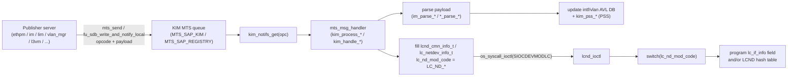

# FLOW-005: KIM MTS notification map (initiator -> KIM handler -> kernel/LCND)

- id: FLOW-005
- component: KIM (Kernel Interface Manager), LCND
- platform: Silicon One (default); platform-specific branches called out inline
- status: verified (source via cscope; key fields + create/delete handler ordering corroborated on a live switch -- see Appendix G, incl. G.4 live config-churn capture)
- date: 2026-06-30

Maps every MTS notification KIM subscribes to in `kim_notifs[]` to: (Q1) the
verified initiator(s), (Q2) the KIM handler behavior, (Q3) the kernel/LCND
programming verb + params, and (Q4) the LCND-side hash-table / field programming.

> VOLATILE vs STABLE: anchor on the function/macro names below. File paths are
> stable; line numbers drift and are omitted from the steps. Opcode->initiator
> rows were verified with cscope (`/router/bin/cscope-64 -d -L -0 <OPC> -f
> standalone/cscope.out`) by classifying each reference as a publisher
> (`mts_send`/`fu_mts_send*`/`*_publish_ifdb`/`fu_sdb_write_and_notify_local`)
> vs a subscriber (registration table / `case OPC:`).

---

## 1. Mechanism spine



Registration: `kim_mts_bind*()` walk `kim_notifs[]` (+ `kim_notifs_mcecm[]`, and
`kim_notifs_eth_pcm[]` on fretta) and call `mts_options_set(kimq, opc,
REGISTER|PERSISTENT)`. Source: `standalone/infra/kstack/kim/kim_mts.c`
(`static struct mts_notifs kim_notifs[]`, `kim_notifs_get`).

KIM -> LCND channel: a handler fills `lc_netdev_info_t lcinfo` (per-interface,
`SIOCDEVMODLC`) or `lcnd_cmn_info_t` (global, on `kimctrl`/`kimctrl1`) with
`lc_nd_mod_code = LC_ND_*`, sets `ifr.ifr_data = &lcinfo`, then
`os_syscall_ioctl(sock, SIOCDEVMODLC, &ifr)`. Verb enum `LC_ND_*` and structs
(`lcnd_cmn_info_t`, `lc_if_info_t`, `lc_netdev_info_t`) live in
`standalone/infra/kstack/kim/export/isan/kim_utils.h`.

LCND side: `lcnd_ioctl()` (`standalone/infra/kstack/kspace/lcnd/lcnd.c`) routes
`SIOCDEVMODLC` to two switches:
- `lcnd_mod_ioctl()` -- per-netdev SET cases (program `dev->lc_if_info.*`).
- `lcnd_mod_ioctl_kimctrl()` / `kimctrl_ioctl()` -- global SET cases (program
  LCND global hash tables / arrays).

Other ioctls KIM uses besides `LC_ND_*` mod codes: `SIOCDEVADDLC`/`SIOCDEVDELLC`
(netdev create/delete on `kimctrl`), `SIOCDEVMODPCLC` (PC member list),
`SIOCDEVADDVP` (VPL), `SIOCSCBL` (= `SIOCDEVMODVLANLC`, CBL forwarding bitmap),
`SIOCSPRISECVLANMAP`/`SIOCDPRISECVLANMAP` (PVLAN DB), `SIOCSIFHWADDR` (MAC),
`SIOCSIFMTU` (MTU), `SIOCPUTTHRESHOLD` (inband PPS), and `SIOCSTUNNSMAP`
(`= SIOCDEVPRIVATE + 15`; VMCT peer-IP tunnel-netns map, issued by `kim_mcec.c`
via `os_syscall_ioctl(default_ns_sock, SIOCSTUNNSMAP, &ifr)`; CSCwn08623).

---

## 2. Master table

Legend for "programs": LCND = pushes an `LC_ND_*` mod code; kernel = programs a
Linux netdev directly (MAC/MTU/carrier/netlink); DB = KIM DB/PSS only.

| Opcode (string) | Verified initiator(s) | KIM handler | Programs | Tier |
|---|---|---|---|---|
| IM_IF_CREATED | interface_manager (+ ethpm, lim, eth_pcm, svi, fcoe) MULTI | `kim_process_if_created` | LCND: FLAGS, ENCAP_TYPE, VLAN (+ kernel MAC/MTU) | 1 |
| IM_IF_REMOVED | interface_manager (+ ethpm, lim, eth_pcm, oim, fcoe) MULTI | `kim_process_if_removed` | LCND: LINK_STATE, FLAGS(SI) + netdev delete | 1 |
| IM_PHY_LINK_STATE_CHANGE | eth_port_manager | `kim_process_phy_state_change` | LCND: LINK_STATE, SET_FLEX_PORT_Q | 1 |
| IM_L2_PROTOCOL_STATE_CHANGE | eth_port_manager | `kim_process_l2_state_change` | LCND: LINK_STATE(up only), FLAGS, VLAN | 1 |
| IM_L3_PROTOCOL_STATE_CHANGE | ethpm, lim, im, oim MULTI | `kim_process_l3_state_change` | LCND: LINK_STATE (up+down) | 1 |
| IM_PORT_L2_PARAM_CHANGE | eth_port_manager | `kim_process_port_param_change` | LCND: TUNNEL_INFO, VLAN, ENCAP_TYPE (+ kernel MTU/MAC) | 1 |
| IM_PORT_L3_PARAM_CHANGE | ethpm, lim, im, oim, svi, ofm MULTI | `kim_process_port_param_change` | same as L2 param | 1 |
| KIM_NETDEV_STATE_CHG | ethpm, lim MULTI | `kim_process_netdev_state_change` | LCND: LINK_STATE | 1 |
| KIM_NETDEV_STATE_CHG_NOTIFY | ethpm, svi, ofm, tm, lim (via `kim_state_change_update`) MULTI | `kim_process_netdev_state_change` | LCND: LINK_STATE | 1 |
| PCM_INTERFACE_CHANGED | port_channel_manager | `kim_process_pcm_change` | LCND: PC member list (`SIOCDEVMODPCLC`) | 1 |
| PCM_FOP_CHANGED | port_channel_manager | `kim_process_fop_update` | LCND: PC_FOP_SET / PC_FOP_UNSET | 1 |
| L3VM_CHANGE | l3vm server | `kim_process_vrf_update` | kernel netns/nsid + per-intf helpers (no VRF tbl) | 1 |
| KIM_CREATE_NETDEV | svi, ofm, eth_pcm, ethpm, lim, fc-pm, tm, vim MULTI | `kim_process_if_create_netdev_req` | netdev create + LCND: ADD_LIF_INFO, IOD | 1 |
| IM_NVE_IF_REMOVED ("IM_DELETE_NETDEV") | lim | `kim_process_nve_delete_req` | LCND: LINK_STATE + netdev delete | 1 |
| KIM_GRE_TUN_UPD | tunnel_manager | `kim_process_if_tun_upd` | kernel MTU only (tunnel-create path `#if 0`) | 1 |
| KIM_VPL_INFO_UPDATE | eth_port_manager | `kim_handle_vpl_update` | LCND: VP program (`SIOCDEVADDVP`) | 1 |
| VNTAG_VIF_CHANGE_MSG | vntag_manager (standalone+aci) MULTI | `kim_handle_vntag_vif_update` | LCND: HIFPC_DVIF_UPDATE | 1 |
| KIM_NETFLOW_DP_INTF_UPDATE | netflow_mgr | `kim_process_netflow_dp_intf_update` | LCND: SET_IFINDEX_IOD | 1 |
| KIM_VNTAG_DVIF_UPD | vntag_manager MULTI | `kim_handle_vntag_vlan_dvif_update` | LCND: VLAN_DVIF_SET / VLAN_DVIF_CLEAR | 1 |
| PM_CMI_VLAN_DOT1Q_TAG_NATIVE | port_manager (CLI req) | `kim_handle_dot1_tag_native_vlan` | LCND: PM_DOT1Q_TAG_NATIVE | 1 |
| L3VM_VRF_VNI_CHANGE | l3vm server | `kim_process_l3vm_vrf_vni_change` | LCND: VRF_TBL_SET / VRF_TBL_DEL | 1 |
| VLAN_MGR_SDB_UPDATE_NOTIF | vlan_mgr | `kim_handle_vlan_mgr_sdb_update` | LCND: RSVD_VLAN_BMP, RSVD_PER_PORT_VLAN_BMP, RSVD_VLAN | 1 |
| VLAN_MGR_VLAN_DELETED | vlan_mgr | `kim_process_vlan_del_notif` | LCND: VLAN_IPMC_CLEAR, VLAN_BD_SET(0) + `SIOCDPRISECVLANMAP` | 1 |
| PVLAN_ASSOCIATION_UPDATE | pvlan | `kim_process_pvlan_update` | LCND: `SIOCSPRISECVLANMAP` (PVLAN DB) | 1 |
| VLAN_MGR_VLAN_ATTR_CHG_TO_KIM | vlan_mgr | `kim_process_vlan_vni_change` | LCND: VLAN_IPMC_SET/CLEAR (+ intf lc_vlan on L3 VNI) | 1 |
| VLAN_MGR_REQ_RSP_VLAN_CREATE | vlan_mgr | `kim_process_vlan_create_req` | LCND: VLAN_IPMC_SET | 1 |
| ELTM_VLAN_VNI_CHANGE | eltm | `kim_process_eltm_vlan_sdb_change` | LCND: VLAN_IPMC_SET | 1 |
| ELTM_VLAN_BD_NOTIFY | eltm | `kim_process_eltm_bd_change` | LCND: VLAN_BD_SET | 1 |
| KIM_DROP_NOTIFY_EN | netflow_mgr | `kim_process_kim_drop_notify_en` | LCND: DROP_NOTIFICATION_EN | 1 |
| ETHPM_GLOBAL_PARAM_CHANGE | eth_port_manager | `kim_process_dme_tag_native` | LCND: PM_DOT1Q_TAG_NATIVE | 1 |
| FM_SRV_FEATURE_STATUS | feature_manager | `kim_handle_fm_status_msg` | LCND: FEATURE_STATUS | 1 |
| KIM_INBAND_PPS_SET | emon_psdev (kspace CLI) | `kim_process_inband_pps_set` | kernel: ps-inb threshold (`SIOCPUTTHRESHOLD`) | 1 |
| HMM | hmm server | `kim_handle_hmm_notif` | kernel: router MAC (`SIOCSIFHWADDR`) + ipfib MTS | 1(kernel) |
| NVE_L3_VNI_NOTIFY | nve | `kim_handle_local_l3_vni_notif` | kernel: vxlan netlink + DB | 1(kernel) |
| NVE_PD_IF_MSG | nve (libnve_pd) MULTI | `kim_process_nve_pd_if_msg` | kernel: vxlan netlink reprogram + DB | 1(kernel) |
| VSH_ACFG_GEN | vsh/ascii-cfg server | `kim_process_ascii_gen_msg` | DB / config gen response | 2 |
| KIM_INBAND_PPS_GET | emon_psdev | `kim_process_inband_pps_get` | query (response) | 2 |
| VETHMGR_ADD_VIF_MEMBER | vim | `kim_process_add_vif_member` | DB (not traced to LCND) | 2 |
| VETHMGR_DEL_VIF_MEMBER | vim | `kim_process_del_vif_member` | DB (not traced to LCND) | 2 |
| IM_SAT_FABRIC_PC_PORT_STATE_CHANGE | eth_port_manager | `kim_process_sat_fabric_pc_port_state_change` | see KSTACK-021 | 2 |
| KIM_CBL_UPDATE | pixm | `kim_process_cbl_update` | LCND: per-ifindex vlan_bmp (`SIOCSCBL`) | 1 |
| KIM_FEX_CBL_UPDATE | pixm | `kim_process_fex_cbl_update` | LCND: per-ifindex vlan_bmp (`SIOCSCBL`) | 1 |
| PM_PORT_BRINGUP | port_manager/fc-pm (+ fport) MULTI | `kim_process_port_bringup` | FC bringup (DB) | 2 |
| VDC_ONLINE | vdc_manager | `kim_handle_vdc_online` | DB / VDC bringup; on MTC/SONE reads EthPM SDB (`ethpm_sdb_get_tag_native_state`) -> `kim_prgm_pm_dot1q_tag_native_vlan` (SONE arm was guarded off during an EthPM-SDB-damage crash loop CSCwr90590, re-enabled CSCwr96699) | 2 |
| LC_ONLINE | lc_manager2, pfm, card_client MULTI | `kim_process_lc_online` | **SONE: LCND** -- `kim_program_mirror_gid` (`LC_ND_MIRROR_GID_SET`) + `kim_process_recycle_ports` (`LC_ND_RCY_PORT_GID_SET`); non-SONE returns early (DB only) | **1 (SONE)** |
| LC_OFFLINE | lc_manager2, pfm MULTI | `kim_process_lc_removed` | **SONE: LCND** -- `kim_program_mirror_gid` (`LC_ND_MIRROR_GID_DEL`); non-SONE returns early (DB only) | **1 (SONE)** |
| MCECM_APP_LIB_DB_UPD (mcecm tbl) | mcec server | `kim_process_mcec` | DB | 2 |
| PCM_SDB_PCINFO_UPDATE_BUNDLE_PORT (fretta tbl) | eth_pcm | `kim_process_pcm_sdb_update_bundle_port` | DB | 2 |

> **Correction (2026-07-11, KSTACK-042).** `LC_ONLINE`/`LC_OFFLINE` were previously
> tiered as **Tier-2 "DB"**. Re-verified against `kim_mts.c`: on **Silicon One** both are
> **Tier-1 LCND programmers**. `kim_process_lc_online` (L551) is
> `if(!libutils_is_card_sone()) return`-gated (L561) and calls
> `kim_program_mirror_gid(...,FALSE)` = `LC_ND_MIRROR_GID_SET` (L595) +
> `kim_process_recycle_ports` (L597) -> `libpixm_sone_get_recycle_port_details` ->
> `kim_fill_recycle_port_info` (`LC_ND_RCY_PORT_GID_SET`, L420). `kim_process_lc_removed`
> (L610, SONE-gated L618) calls `kim_program_mirror_gid(...,TRUE)` = `LC_ND_MIRROR_GID_DEL`
> (L640). On non-SONE they return early (DB only). App A already lists the
> `LC_ND_MIRROR_GID_*` / `LC_ND_RCY_PORT_GID_SET` verbs; the missing link was the
> LC_ONLINE/LC_OFFLINE opcode -> handler initiator (now in App B). Process-side spine:
> FLOW-011 (`references/kim-process-arch.md`) + `architecture/kim-process-architecture.md`.

---

## 3. Tier-1 notifications (full Q1-Q4)

Each block: Q1 initiator(s) + payload, Q2 KIM handler behavior + `lc_if_info`/PSS,
Q3 `LC_ND_*` verb + `lcinfo` params, Q4 LCND case + table/field (see Appendix A
for the verb->table detail).

### 3.1 Interface lifecycle and link/flags

#### IM_IF_CREATED -> `kim_process_if_created`
- Q1: `interface_manager` `im_if_create_send` / `im_ifdb_publish_if_created`
  (-> `im_publish_ifdb` -> `fu_vdc_sdb_write_and_notify_local`, dest
  `MTS_SAP_REGISTRY`). MULTI-SENDER: also `ethpm_ifdb_publish_if_created` /
  `ethpm_si_ifdb_publish_if_created` (ethpm), `lim_ifdb_publish_if_created`
  (lim), `pcm_sdb_publish_if_created` (eth_pcm), `svi_add_to_ifdb_and_notify`
  (svi), `fcoe_mgr_sdb_publish_vfc_created` (fcoe). Payload `im_if_created_pld_t`
  (`num`, `ifinfo[]`: `ifindex`, `iod`, `im_intf_type`, `is_phy_port_vpc`).
- Q2: `im_parse_if_created`. Skips unsupported/tunnel; mgmt -> `kim_add_mgmt_intf`
  only (no LCND); L3 routed -> skipped; L2 switchport -> resolves
  `query_ifindex` (self or parent PC via `pcm_get_pc_for_port`) and native vlan
  via `ethpm_im_get_ifindex_vlan_list`. Updates `lc_macaddr`, `lc_flags`,
  `lc_mtu`, `lc_encap_type`, `lc_vlan`; PSS ops `KIM_PSS_OPER_INTF_CHG_*`.
- Q3: `kim_set_ifflags` -> `LC_ND_FLAGS` (`lc_flags |= LC_FLAGS_SWITCHPORT`);
  `kim_set_lc_encap_type` -> `LC_ND_ENCAP_TYPE` (`lc_encap_type`);
  `kim_vlan_set` (if vlan!=0) -> `LC_ND_VLAN` (`lc_vlan`). Kernel-only:
  `kim_set_switchport_mac` (`SIOCSIFHWADDR`), `kim_set_ifmtu` (`SIOCSIFMTU`).
- Q4: per Appendix A rows LC_ND_FLAGS / LC_ND_ENCAP_TYPE / LC_ND_VLAN ->
  `lcnd_mod_ioctl` writes `dev->lc_if_info.{lc_flags,lc_encap_type,lc_vlan}`;
  SI subintf also populates the parent's per-dev `lcnd_vlan_htab`.

#### IM_IF_REMOVED -> `kim_process_if_removed`
- Q1: `interface_manager` `im_if_remove_send` / `im_mgmt_ifdb_publish_if_removed`.
  MULTI-SENDER: `ethpm_ifdb_publish_if_removed` (ethpm),
  `lim_ifdb_publish_if_removed` (lim), `pcm_sdb_publish_if_removed` (eth_pcm),
  `oim_send_if_removed_msg` (oim, `mts_send`), `fcoe_mgr_sdb_publish_vfc_removed`.
  Payload `im_if_removed_pld_t` (`num`, `ifinfo[]`: `ifindex`, `iod`).
- Q2: `im_parse_if_removed`. PC pre-delete -> `kim_sanpo_cleanup`
  (`kim_update_pc_if` -> `SIOCDEVMODPCLC`); then `kim_remove_if` (single) or
  `kim_remove_iflist` (batch). Clears `LC_FLAGS_UP`, LPSS delete, AVL remove.
- Q3: `kim_set_if_link_state(FALSE)` -> `LC_ND_LINK_STATE` (`link_state=0`) before
  delete; optional parent `kim_set_ifflags(0, LC_FLAGS_SI_PARENT)` -> `LC_ND_FLAGS`.
- Q4: `LC_ND_LINK_STATE` (carrier off) + netdev teardown via `SIOCDEVDELLC`
  (`del_lc_net_device`, removes `lcnd_ifindex_htab` entry). The delete itself is
  not an `LC_ND_*` verb.

#### IM_PHY_LINK_STATE_CHANGE -> `kim_process_phy_state_change`
- Q1: `eth_port_manager` `ethpm_send_port_phy_state_change`
  (`ethpm_publish_ifdb` -> `fu_sdb_write_and_notify_local`, `MTS_SAP_REGISTRY`).
  Single in-tree publisher. Payload `im_phy_link_state_change_pld_t` (`ifinfo[]`:
  `ifindex`, `state` = `pm_port_state_t`).
- Q2: `im_parse_phy_link_state_change`. On UP and flex port (Paris/Berlin):
  `kim_update_flex_port_qbase`. Always: `kim_set_if_link_state(state & UP)`.
- Q3: `kim_update_flex_port_qbase` -> `LC_ND_SET_FLEX_PORT_Q` (`lc_ifindex`,
  `lc_qi`); `kim_set_if_link_state` -> `kim_link_state_change` ->
  `LC_ND_LINK_STATE` (`link_state` 1/0).
- Q4: `LC_ND_LINK_STATE` -> `lcnd_set_carrier`/`netif_carrier_off`;
  `LC_ND_SET_FLEX_PORT_Q` -> `lcnd_set_flex_q_base` writes target `lc_if_info.lc_qi`
  (target found via `lcnd_ifindex_htab_get`).

#### IM_L2_PROTOCOL_STATE_CHANGE -> `kim_process_l2_state_change`
- Q1: `eth_port_manager` `ethpm_ifdb_publish_state_change` (L2 branch) /
  `ethpm_si_publish_oper_status` (L2 SI). L2 path uses a CA remote addr
  `mts_remote_addr(MTS_NODE_BOTH_SUP_ALL_LC, MTS_SAP_REGISTRY)`. Payload iterated
  via `im_parse_l2_protocol_state_change_iterate` -> `im_l2_protocol_state_change_info_t`
  (`ifindex`, `iod`, `link_state`, `port_mode`, `native_vlan`, `access_vlan`).
- Q2: computes `port_up = (link_state & UP) | (port_mode==TRUNK)`; PC / eth-PC
  without FoP forces `port_up=FALSE`. Asymmetric policy (CSCvd11194): only calls
  link-state when `port_up` (never drives kernel iface DOWN here). `info_vlan` =
  native (trunk/pvlan-trunk) else access.
- Q3: when `port_up` -> `kim_set_if_link_state` -> `LC_ND_LINK_STATE(1)`;
  switchport -> `kim_set_ifflags` -> `LC_ND_FLAGS(LC_FLAGS_SWITCHPORT)`;
  `info_vlan!=0` -> `kim_vlan_set` -> `LC_ND_VLAN(lc_vlan)`.
- Q4: see Appendix A LC_ND_LINK_STATE / LC_ND_FLAGS / LC_ND_VLAN. No LCND push on
  link-down (by design).

#### IM_L3_PROTOCOL_STATE_CHANGE -> `kim_process_l3_state_change`
- Q1: MULTI-SENDER: ethpm (`ethpm_ifdb_publish_state_change` L3 branch,
  `ethpm_si_publish_oper_status`, `ethpm_lb_publish_oper_status`), lim
  (`lim_overlay_publish_l3_proto_change`, `lim_nve_publish_l3_proto_change`), im
  (`im_mgmt_ifdb_publish_state_change`), oim (`oim_send_l3_proto_state_change_msg`,
  `mts_send`). Payload `im_l3_protocol_state_change_pld_t` (`ifinfo[]`: `ifindex`,
  `state`).
- Q2: `im_parse_l3_protocol_state_change`; per entry
  `kim_set_if_link_state(state & UP)`.
- Q3: `LC_ND_LINK_STATE` (`link_state` 1/0). Unlike L2, both UP and DOWN pushed.
- Q4: `LC_ND_LINK_STATE` carrier on/off.

#### IM_PORT_L2_PARAM_CHANGE / IM_PORT_L3_PARAM_CHANGE -> `kim_process_port_param_change`
- Q1: L2 param: `eth_port_manager`
  `ethpm_ifdb_publish_param_change_w_all_drop` /
  `ethpm_ifdb_publish_l2_param_change_for_flowctrl_rx`. L3 param MULTI-SENDER:
  ethpm + lim (`lim_overlay_publish_l3_param_change`) + im
  (`im_mgmt_ifdb_publish_param_change`) + oim + svi
  (`svi_update_params_in_ifdb_and_notify`) + ofm
  (`l3vni_update_params_in_ifdb_and_notify`). Payload `im_port_param_change_pld_t`
  with a TLV/change-bitset.
- Q2: iterate with `im_port_param_change_port_iterator_create` +
  `im_parse_port_param_change_port_chg_bset`, gated by
  `im_prm_chg_bset_is_bit_set(IM_MSG_TLV_*)`.
- Q3 (per TLV bit):
  - `IM_MSG_TLV_TUNNEL_TYPE` -> `kim_tunnel_info_set` -> `LC_ND_TUNNEL_INFO`
    (`lc_iod`, `tunnel_type`, `lif`, `lc_ifindex`, `lc_ifname`, `ltl`).
  - `IM_MSG_TLV_SUBINTF_ENCAP` -> `kim_vlan_set` -> `LC_ND_VLAN` (`lc_vlan`).
  - `IM_MSG_TLV_ETHERTYPE` -> `kim_set_lc_encap_type` -> `LC_ND_ENCAP_TYPE`.
  - `IM_MSG_TLV_MTU` -> `kim_set_ifmtu` (kernel `SIOCSIFMTU`, no LCND).
  - `IM_MSG_TLV_ROUTER_MAC` -> `kim_set_router_mac` (`SIOCSIFHWADDR`) +
    `kim_send_msg_to_ipfib` (`MTS_OPC_KIM_DOWNLOAD_ADJ`), no LCND.
- Q4: LC_ND_TUNNEL_INFO -> `lcnd_lif_htab_insert` + `dev->lc_if_info.{lif,lc_iod,
  tunnel_type}`; LC_ND_VLAN / LC_ND_ENCAP_TYPE as above.

#### KIM_NETDEV_STATE_CHG / KIM_NETDEV_STATE_CHG_NOTIFY -> `kim_process_netdev_state_change`
- Q1: STATE_CHG (req/resp): ethpm `ethpm_si_set_netdev_state`, lim
  `lim_overlay_send_kim_netdev_state_change_req`. NOTIFY (fire-and-forget):
  shared helper `kim_state_change_update` (in `kim_intf.c`) called by
  `svi_kim_state_change_update` (svi), `l3vni_kim_state_change_update` (ofm),
  `ethpm_publish_ifstate_to_kim` / `ethpm_bringup_netdev` (ethpm),
  `tm_upd_protocol_state_to_kim` (tm); plus direct `ethpm_lb_set_netdev_state`
  and `lim_nve_send_kim_netdev_state_change_req`. Dest `MTS_SAP_KIM`. Payload
  `kim_netdev_statechg_pld_t` (`ifinfo[]`: `ifindex`, `iod`, `port_state`,
  `netdev_prog_sts`).
- Q2: `kim_parse_netdev_statechg_alloc_req`; supported-intf check;
  `kim_set_if_link_state(port_state & UP)`, stores result in `netdev_prog_sts`.
  MTS response only for `KIM_NETDEV_STATE_CHG` (not NOTIFY).
- Q3: `LC_ND_LINK_STATE`.
- Q4: carrier on/off.

### 3.2 Port-channel

#### PCM_INTERFACE_CHANGED -> `kim_process_pcm_change`
- Q1: `port_channel_manager` `notify_interface_changed` (via `pcm_pc_send_if_changed`
  etc.; `common/pcm_notify.c` or `new_server/pcm_notify.c` per image) ->
  `fu_mts_send_notify`, `MTS_SAP_REGISTRY`. Payload `pcm_mts_interface_changed_t`
  (`ifindex`, `members`, `removed`).
- Q2: `pcm_ntoh_interface_changed_payload`; rebuilds `lc_pc_members[]`,
  `rem_pc_members[]`; `kim_pcm_update_parent` on add/remove;
  `kim_handle_hif_pc_vp_update` (FEX flag / `lc_dvp`); MTU via `kim_set_ifmtu`.
  PSS `KIM_PSS_OPER_INTF_CHG_PC_MEMBER`.
- Q3/Q4: `kim_update_pc_if` -> `SIOCDEVMODPCLC` (members/removed/oper/fex_pc_vp);
  this is a PC-specific ioctl, not an `LC_ND_*` mod code.

#### PCM_FOP_CHANGED -> `kim_process_fop_update`
- Q1: `port_channel_manager` `pcm_notify_fop_changed` (<- `pcm_fop_changed`),
  `fu_mts_send_w_errno` / `fu_mts_send`, `MTS_SAP_REGISTRY`. Payload
  `pcm_mts_fop_changed_t` (`pcifindex`, `old`, `new`).
- Q2: `kim_handle_fop_update`; sets `nxos_pc_fop = new_fop_if`; SAN/switchport PC
  side effects (MAC, SWITCHPORT flag, link). PSS `KIM_PSS_OPER_INTF_CHG_FOP`.
- Q3: `new_fop == INVALID` -> `LC_ND_PC_FOP_UNSET`, else `LC_ND_PC_FOP_SET`
  (`lc_if_info.nxos_pc_fop`).
- Q4: writes `dev->lc_if_info.nxos_pc_fop` (set or 0).

### 3.3 VRF / netns

#### L3VM_CHANGE -> `kim_process_vrf_update`
- Q1: `l3vm` server `l3vm_vrf_send_msg` / `l3vm_passive_vrf_send_msg` /
  `l3vm_tib_send_msg` / `l3vm_if_send_msg` -> `l3vm_send_mts_request` ->
  `mts_send`, `MTS_SAP_REGISTRY`. MULTI internal publish paths, single owning
  server. Payload `l3vm_context_notify_msg_t` (+ `l3vm_table_notify_msg_t` /
  `l3vm_if_notify_msg_t` by `mtype.minor`).
- Q2: TABLE_CREATE(IPv4) -> `kim_handle_netns_add` (ns fd + nsid map);
  CONTEXT_PASSIVE_DELETE -> `kim_handle_netns_delete`; IF_CONTEXT_CHANGE* ->
  `kim_process_vrf_move` (-> `kim_netns_add_intf`, then `kim_set_switchport_mac`/
  `kim_set_router_mac`, `kim_set_ifflags`, `kim_set_ifmtu`, `kim_vlan_set`).
- Q3: no `LC_ND_VRF_TBL_*` here (that is L3VM_VRF_VNI_CHANGE). The interface-move
  helpers may re-push `LC_ND_FLAGS`/`LC_ND_VLAN`/`LC_ND_ENCAP_TYPE` for the moved
  intf; primary effect is kernel netns move + nsid map.
- Q4: netns/nsid programming (`LC_ND_SET_NSID_MAP` via `kimctrl` for ns_id map);
  any re-pushed flag/vlan verbs land in `lcnd_mod_ioctl` as usual.

#### L3VM_VRF_VNI_CHANGE -> `kim_process_l3vm_vrf_vni_change`
- Q1: `l3vm` server `l3vm_notify_vni_change` -> `l3vm_send_mts_request` ->
  `mts_send`, `MTS_SAP_REGISTRY`. Payload `l3vm_vni_t` (`vrf_id`, `vni_id`).
- Q2: resolves `context_name`/`table_id`; writes VRF PSS (`kim_pss_vrf_info`,
  `KIM_PSS_OPER_VRF_ADD`); creates/deletes bridge veth. Discards if netns missing
  or during `kim_issu_restart`.
- Q3: `kim_program_vrf_tbl` -> `LC_ND_VRF_TBL_SET` / `LC_ND_VRF_TBL_DEL`,
  `lcinfo.vrf_tbl.{tbl_id, vrf_id, vni_id}`, `SIOCDEVMODLC` on `kimctrl`.
- Q4: `lcnd_vrf_tbl_htab_insert/del` keyed by `tbl_id` -> `{vrf_id, vni_id}`.

### 3.4 Netdev create / NVE / tunnel / VPL / netflow

#### KIM_CREATE_NETDEV -> `kim_process_if_create_netdev_req`
- Q1: MULTI-SENDER (8 managers): svi `svi_create_netdev`, ofm
  `l3vni_create_netdev`, eth_pcm `pcm_pc_create_netdev`/`pcm_lc_config_create_netdev`,
  ethpm `ethpm_send_netdev_create` (+ lb/si variants), lim
  `lim_nve_send_kim_netdev_create_req`/`lim_overlay_send_kim_netdev_create_req`,
  fc-pm `pm_send_netdev_create`, tm `tm_send_create_notification_kim`, vim
  `vim_niv_vif_send_vif_create_to_kim`/`vim_veth_create_netdev_req`. Dest
  `MTS_SAP_KIM`. Payload `kim_netdev_create_pld_t` (`ifinfo[]`: `ifindex`, `iod`,
  `ifinfo_flags`).
- Q2: `kim_parse_netdev_create_alloc_req`; filter `is_kim_supp_intf`; per intf
  `kim_create_if` populates the full `lc_if_info` (ifname/ifindex/iod/flags/
  macaddr/router_macaddr/dmod/dpid/ltl/portindex/vlan/lif/lnx_ifindex/ns_name/
  vlan_bmp). `kim_insert_intf_in_db` -> `KIM_PSS_OPER_INTF_ADD`.
- Q3: `SIOCDEVADDLC` (full `lc_if_info` blob via `kimctrl`); if `lif!=0` ->
  `LC_ND_ADD_LIF_INFO`; if intf exists and iod changed -> `kim_iod_set` ->
  `LC_ND_IOD`.
- Q4: `SIOCDEVADDLC` -> `add_lc_net_device` -> `lc_dev_init` ->
  `lcnd_ifindex_htab_insert`; `LC_ND_ADD_LIF_INFO` -> `lcnd_lif_htab_insert`
  (key `lif` -> `lc_if_info`); `LC_ND_IOD` -> `dev->lc_if_info.{lc_iod,lc_phy_iod}`.

#### IM_NVE_IF_REMOVED ("IM_DELETE_NETDEV") -> `kim_process_nve_delete_req`
- Q1: `lim` `lim_nve_if_remove_publish` (`lim_publish_ifdb_ex` ->
  `fu_sdb_write_and_notify_local`, `MTS_SAP_REGISTRY`). Payload `im_if_created_pld_t`
  (reused for NVE ifindex list).
- Q2: `im_parse_nve_if_removed`; NVE ifindexes -> `kim_remove_if`.
- Q3: link-down `LC_ND_LINK_STATE` then `SIOCDEVDELLC`.
- Q4: carrier off + `del_lc_net_device` (remove `lcnd_ifindex_htab`).

#### KIM_GRE_TUN_UPD -> `kim_process_if_tun_upd`
- Q1: `tunnel_manager` `tm_upd_lnx_gre_tunnel` -> `tm_send_req_wait_resp` ->
  `fu_mts_send`, `MTS_SAP_KIM`. Payload `kim_lnx_tun_params_t`.
- Q2: `kim_parse_lnx_tun_params_req`. Tunnel create/update body is `#if 0`
  (disabled). Active path: on `PMTU_CHANGED|MTU_CHANGED` -> `kim_set_ifmtu`.
- Q3/Q4: kernel MTU only (`SIOCSIFMTU`). No `LC_ND_*` from this handler.
  (`LC_ND_TUNNEL_INFO` is pushed from the port-param tunnel-type path, not here.)

#### KIM_VPL_INFO_UPDATE -> `kim_handle_vpl_update`
- Q1: `eth_port_manager` `ethpm_kim_vpl_alloc_info_send` /
  `ethpm_kim_vpl_dealloc_info_send` -> `ethpm_send_request` ->
  `fu_mts_send_w_errno`, `MTS_SAP_KIM`. Payload `kim_vpl_info_update_t`
  (`if_index`, `vlan_bmp`, `oper`, `status`).
- Q2: `kim_parse_vpl_info_update_req`; per-vlan `pixm_lib_ifidx_vlan_to_di` -> VP;
  updates `if_info.vlan_bmp`; builds `lc_vp_info_t`. PSS VLAN_BMP_ADD/DEL (or MCT).
- Q3/Q4: `kim_update_vpl_info` -> `SIOCDEVADDVP` (VP info), not `SIOCDEVMODLC`.

#### KIM_NETFLOW_DP_INTF_UPDATE -> `kim_process_netflow_dp_intf_update`
- Q1: `netflow_mgr` `nfm_inform_kim_on_netflow_datapath_interface`
  (`fu_mts_send_w_errno`, `MTS_SAP_KIM`). Payload `kim_netflow_dp_intf_update_t`
  (`ifinfo[]`: `ifindex`, `iod`).
- Q2: `kim_parse_netflow_dp_intf_update_req`; per entry
  `kim_netflow_datapath_ifindex_iod_set`. No DB/PSS update (ioctl only).
- Q3: `LC_ND_SET_IFINDEX_IOD` on the netflow DP pseudo-dev (`lc_iod`, `lc_ifindex`).
- Q4: `dev->lc_if_info.{lc_iod, lc_phy_iod (=lc_iod), lc_ifindex}`.

### 3.5 VNTAG / DVIF

#### VNTAG_VIF_CHANGE_MSG -> `kim_handle_vntag_vif_update`
- Q1: `vntag_manager` `vntag_hifpc_update_span` -> `fu_mts_send`,
  `mts_remote_addr(MTS_NODE_ACTIVE_SUP_ALL_SFLC, MTS_SAP_REGISTRY)` (standalone)
  / `MTS_NODE_BOTH_SUP_ALL_DC3_LC_IN_VDC` (aci). MULTI (standalone vs aci).
  Payload `vntag_get_ifindex_vif_pld_t` (`info[]`: `if_index`, `vif`).
- Q2: `vntag_parse_get_vif_for_ifindex_pld`; per entry (skip vif==0)
  `kim_update_satpc_vif_update`. Sets `lc_dvif`; PSS `KIM_PSS_OPER_INTF_CHG_DVIF`.
- Q3: `LC_ND_HIFPC_DVIF_UPDATE` (`lc_if_info.lc_dvif`).
- Q4: `dev->lc_if_info.{lc_dvif, nxos_fex_pc_parent}` (FEX PC parent via
  `lcnd_fetch_pc_fop_lcnd`).

#### KIM_VNTAG_DVIF_UPD ("VNTAG_VLAN_DVIF_UPDATE") -> `kim_handle_vntag_vlan_dvif_update`
- Q1: `vntag_manager` `vntag_stp_set_vlan_cbl_dvif_alloc_upd_kim`,
  `vntag_stp_set_vlan_cbl_dealloc_dvif`, `vntag_dvif_sharing_update_kim`,
  `vntag_dvif_swap_kim_upd` -> `fu_mts_send`, `MTS_SAP_KIM`. MULTI send-sites.
  Payload `kim_vntag_dvif_upd_msg_t` (`is_alloc`, `info[]`: `vlan`, `dvif`).
- Q2: `kim_parse_vntag_dvif_upd_msg`; per entry `kim_process_dvif`; vlan AVL
  `vlan_info.dvif` insert/update/delete + `kim_pss_vlan_info`.
- Q3: alloc -> `LC_ND_VLAN_DVIF_SET`, del -> `LC_ND_VLAN_DVIF_CLEAR`
  (`lcinfo.info.{vlan, dvif}`).
- Q4: `lcnd_set_dvif`/`lcnd_clear_dvif` -> `lcnd_dvif_htab` keyed by `vlan` -> `dvif`.

### 3.6 VLAN / BD / IPMC / PVLAN / native-tag

#### VLAN_MGR_SDB_UPDATE_NOTIF -> `kim_handle_vlan_mgr_sdb_update`
- Q1: `vlan_mgr` `vlan_mgr_send_sdb_update_notif` -> `mts_send_notify`
  (`vlan_mgr_q_mts`, registry). Payload `uint32` (`sdb_updated=TRUE`); no per-msg
  fields (KIM pulls reserved-vlan bitmaps from shared state).
- Q2: `vlan_get_dyn_rsvd_vlans` -> copies `g_dyn_rsvd_vlan_bmp` /
  `g_dyn_rsvd_perport_vlan_bmp`; on SONE extracts `g_kim_vxlan_mct_rsvd_vlan`.
  Global config only, no `lc_if_info`/intf PSS.
- Q3: `kim_process_rsvd_vlan(bmp, LC_ND_RSVD_VLAN_BMP)` and
  `LC_ND_RSVD_PER_PORT_VLAN_BMP` (`info.vlan`=min bit, `info.vni`=max contiguous);
  `kim_prgm_mct_rsvd_vlan` -> `LC_ND_RSVD_VLAN` (`info.vlan=rsvd_vlan`). On `kimctrl`.
- Q4: LCND global reserved-vlan handling (kimctrl path).

#### VLAN_MGR_VLAN_ATTR_CHG_TO_KIM -> `kim_process_vlan_vni_change`
- Q1: `vlan_mgr` `vlan_mgr_send_attr_change_notif` (<- `vlan_send_attr_change_notif`
  <- `vlan_attr_chg_send_attr_change_to_kim` / l3vni variants) -> `mts_send`,
  `mts_local_addr(MTS_SAP_KIM)`. Payload `vlan_attribute_change_notification_t`.
- Q2: `vlan_mgr_parse_notification_msg`; filters `VLAN_ATTR_MTRM_SEGMENT_ID` /
  `..._L3VNI_SEGMENT_ID`; `sw_bd = attr->vlan.vlan_id`; computes
  `eltm_query_vlan_to_vfi`. L3 VNI add sets `if_info.lc_info.lc_vlan = sw_bd` +
  `kim_pss_intf_info`.
- Q3: VNI delete -> `kim_process_ipmc(...,TRUE)` -> `LC_ND_VLAN_IPMC_CLEAR`; VNI
  add -> `kim_process_ipmc(...,FALSE)` -> `LC_ND_VLAN_IPMC_SET`
  (`info.{vlan,vni,ipmc}`), on `kimctrl`.
- Q4: `lcnd_set_ipmc` -> `lcnd_ipmc_htab` (vlan->{vni,ipmc}) + `lcnd_vni_vlan_htab`.

#### VLAN_MGR_VLAN_DELETED -> `kim_process_vlan_del_notif`
- Q1: `vlan_mgr` `vlan_send_multi_vlan_delete_notif` -> `mts_send_notify_opts`
  (normal) or `mts_send` to `MTS_SAP_KIM` (extended-BD). Payload
  `vlan_delete_notif_payload_t` (`vdc_vlan.vlan_id`).
- Q2: per record tears down IPMC, BD, PVLAN map.
- Q3: `kim_process_ipmc(vlan,0,0,TRUE)` -> `LC_ND_VLAN_IPMC_CLEAR`;
  `kim_process_bd(vlan,0)` -> `LC_ND_VLAN_BD_SET` (`info.vlan`, `info.vni=0`);
  `SIOCDPRISECVLANMAP` (`lcnd_pvlan_map`) to clear PVLAN.
- Q4: IPMC htab clear; `lcnd_set_bd` -> `lcnd_vlan_bd_htab` (vlan->bd=0);
  `lcnd_pvlan_db_del`.

#### VLAN_MGR_REQ_RSP_VLAN_CREATE -> `kim_process_vlan_create_req`
- Q1: `vlan_mgr` `vlan_create_ev_seq_send_fn` / `l3vni_vlan_create_ev_seq_send_fn`
  -> `mts_send` to `MTS_SAP_ELTM` or `MTS_SAP_KIM` per ev-seq step. Payload TLV
  from `vlan_create_seq_req_t` (`vlan_id`, `segment_id`).
- Q2: skip if `!segment_id` or `segment_id >= 0x80000000`; `eltm_query_vlan_to_vfi`.
- Q3: `kim_process_ipmc(vlan, segment_id, ipmc, FALSE)` -> `LC_ND_VLAN_IPMC_SET`.
- Q4: `lcnd_ipmc_htab` / `lcnd_vni_vlan_htab`.

#### ELTM_VLAN_VNI_CHANGE -> `kim_process_eltm_vlan_sdb_change`
- Q1: `eltm` `eltm_sdb_update_vni` -> `fu_mts_send_notify` (`eltm_q_mts`, registry).
  Payload `eltm_vlan_vni_change_msg_t` (`vlan_id`, `ipmc`, `vni`, network order).
- Q2: early return if `!vni` or `vni >= 0x80000000`.
- Q3: `kim_process_ipmc(vlan, vni, ipmc, FALSE)` -> `LC_ND_VLAN_IPMC_SET`.
- Q4: `lcnd_ipmc_htab` / `lcnd_vni_vlan_htab`.

#### ELTM_VLAN_BD_NOTIFY -> `kim_process_eltm_bd_change`
- Q1: `eltm` `eltm_handle_eltmc_vlan_create_rsp` -> `fu_mts_send_notify`
  (`eltm_q_mts`, registry). Payload `eltmc_vlan_create_rsp_msg_t`
  (`info[]`: `vlan`, `bd`).
- Q2: per entry `kim_process_bd(vlan, bd)`. (BD carried in `lcnd_cinfo.vni` field,
  per KSTACK-002 `lc_vlan = sw_bd`.)
- Q3: `LC_ND_VLAN_BD_SET` (`info.vlan=vlan`, `info.vni=bd`), on `kimctrl`.
- Q4: `lcnd_set_bd` -> `lcnd_vlan_bd_htab` keyed by `vlan` -> `bd`.

#### PVLAN_ASSOCIATION_UPDATE -> `kim_process_pvlan_update`
- Q1: `pvlan` `pvlan_sdb_update_association_and_notify`
  (-> `pvlan_sdb_write_and_notify_local` -> `fu_sdb_write_and_notify_local`,
  `MTS_SAP_REGISTRY`). Payload `pvlan_association_update_t` (`primary_vlan`,
  `secondary_vlan[]`).
- Q2: `pvlan_parse_association_update`; builds `lcnd_pvlan_assoc{op=PVLAN_ADD,
  data.{pri_vlan, sec_vlan}}`. No KIM DB/PSS.
- Q3/Q4: `SIOCSPRISECVLANMAP` on `kimctrl` -> `lcnd_pvlan_db_insert(pri, sec)`.
  Does NOT use `LC_ND_PVLAN_FLAGS`. That verb is a separate per-dev flag-sync path
  driven directly by **vlan_mgr** (`vlan_set_lcnd_flags` -> `SIOCDEVMODLC`), called
  from `mts_vlan_im_l2_protocol_state_change_notif` /
  `mts_vlan_im_l2_bundle_phy_state_change_notif` / PSS restore -- it maps the port
  mode to one `LC_FLAGS_*` bit (TRUNK_ISOLATED / TRUNK_PROMISCUOUS / PVLAN_HOST /
  PVLAN_PROMISCUOUS / DOT1Q_TUNNEL / SWITCHPORT_ACCESS). It does NOT flow through
  KIM.

#### PM_CMI_VLAN_DOT1Q_TAG_NATIVE -> `kim_handle_dot1_tag_native_vlan`
- Q1: `port_manager` CLI `pm_cli_ethpm_vlan_dot1q_tag_native` /
  `pm_cli_show_ethpm_vlan_dot1q_tag_native` (CMI req/rsp). MTC-platform SET also
  targets `MTS_SAP_KIM`. Payload `pm_cfg_tlv_t` / `pm_vlan_dot1q_tag_native_t`.
- Q2: GET_REQ returns response only (no LCND). SET computes
  `enabled = (tag != PM_VLAN_DOT1Q_TAG_NATIVE_DISABLE)`; sets
  `g_kim_cfg.pm_tag_native_vlan`.
- Q3: `kim_prgm_pm_dot1q_tag_native_vlan` -> `LC_ND_PM_DOT1Q_TAG_NATIVE`
  (`info.pm_tag_native_vlan`), on `kimctrl`.
- Q4: writes LCND global `pm_tag_native_vlan`.

#### ETHPM_GLOBAL_PARAM_CHANGE -> `kim_process_dme_tag_native`
- Q1: `eth_port_manager` `ethpm_add_global_config_to_sdb` ->
  `ethpm_ifdb_publish_global_param_change` -> `ethpm_publish_ifdb` ->
  `fu_sdb_write_and_notify_local`, `MTS_SAP_REGISTRY`. Payload
  `ethpm_global_param_change_pld_t` (TLV `IM_MSG_TLV_CONFIG_NATIVE_VLAN`).
- Q2: validates TLV; `tag_native = htonl(...)`.
- Q3: `kim_prgm_pm_dot1q_tag_native_vlan` -> `LC_ND_PM_DOT1Q_TAG_NATIVE`.
- Q4: writes LCND global `pm_tag_native_vlan`.

### 3.7 Feature status / drop / inband PPS

#### FM_SRV_FEATURE_STATUS -> `kim_handle_fm_status_msg`
- Q1: `feature_manager` `fm_notify_feature_status` (+ uuid/instance variants in
  `libfm.c`) -> `mts_send_notify`. Payload `fm_feature_status_t` (`uuid`, `name`).
- Q2: filters by feature name + `SRVUUID_FEATURE_MGR`; handles
  MPLS_SEGMENT_ROUTING, MPLS_EVPN, NGMVPN, SECURITYGROUP. PSS `kim_pss_feature_info`.
- Q3: `kim_prgm_feature_status` -> `LC_ND_FEATURE_STATUS`
  (`info.feature_status.{feature_id, enabled}`), on `kimctrl`.
- Q4: `lcnd_find/add_entry_to_feature_statuses` -> `lcnd_feature_statuses[]`
  (or `multicast_udp` for the UDP-multicast-clone feature).

#### KIM_DROP_NOTIFY_EN -> `kim_process_kim_drop_notify_en`
- Q1: `netflow_mgr` `nfm_send_drop_notify_mts_to_kim` -> `mts_send`, `MTS_SAP_KIM`.
  Payload `bool`.
- Q2: `kim_set_drop_notify_en`; PSS `kim_pss_drop_notify_feature_info`.
- Q3: `LC_ND_DROP_NOTIFICATION_EN` (`lcinfo.drop_notify_en`).
- Q4: writes LCND global `drop_notification_en`.

#### KIM_INBAND_PPS_SET -> `kim_process_inband_pps_set`
- Q1: `emon_psdev` (kspace CLI) `psinb_lcnd_threshold` -> `mts_send`, `MTS_SAP_KIM`.
  Payload `psdev_threshold` (`rx_threshold`, `tx_threshold`, `throttle`).
- Q2: `kim_set_inband_pps` -> `SIOCPUTTHRESHOLD` on `INBAND_INTF_NAME`; read-back;
  PSS `kim_pss_inband_info`.
- Q3/Q4: kernel ps-inb driver (not LCND).

### 3.8 Kernel-only (no LCND mod code)

#### HMM -> `kim_handle_hmm_notif`
- Q1: `hmm` server `hmm_notify_clients` / `hmm_process_register_msg` -> `mts_send`
  to per-client SAP. Payload `hmm_notify_clients_msg_t` (`u.if_index[]`, `flags`).
- Q2: `hmm_dispatch` -> `kim_process_hmm_notification`; FWD_MODE (non-SSO): ANYCAST
  -> `kim_set_router_mac(anycast_mac)`, STANDARD -> get/set router mac; then
  `kim_send_msg_to_ipfib` (`MTS_OPC_KIM_DOWNLOAD_ADJ`). PSS
  `KIM_PSS_OPER_INTF_CHG_ROUTER_MAC`.
- Q3/Q4: kernel `SIOCSIFHWADDR` (no `LC_ND_*`).

#### NVE_L3_VNI_NOTIFY -> `kim_handle_local_l3_vni_notif`
- Q1: `nve` `nve_notify_l3_vni_vlan` / `nve_local_vrf_vni_notify_send` ->
  `nve_mts_send`, `MTS_SAP_REGISTRY`. Payload `nve_l3_vni_vlan_notify`
  (`l3_vni_vlan[]`: `vni`, `vlan_id`).
- Q2: updates vlan DB `vni_layer`; add -> `kim_store_vrf_info_from_vlan`,
  `kim_vxlan_intf_kernel_create`; PSS `kim_pss_vlan_info`.
- Q3/Q4: kernel vxlan netlink (no `LC_ND_*`).

#### NVE_PD_IF_MSG -> `kim_process_nve_pd_if_msg`
- Q1: `nve` libnve_pd `nve_pd_cmn_send_if_msg` (+ n6k/n7k/n9k wrappers) ->
  `mts_send`, `MTS_SAP_REGISTRY`. MULTI (platform wrappers). Payload
  `nve_pd_if_msg_t` (`primary_ip`, `secondary_ip`).
- Q2: picks primary/secondary per DCI-advertise-pip; `kim_handle_vxlan_nve_local_ip_update`.
  PSS `kim_pss_global_info`.
- Q3/Q4: kernel vxlan netlink reprogram per VRF table_id (no `LC_ND_*`).

### 3.9 CBL forwarding-VLAN bitmap (STP/EVPN port state)

Both handlers program the per-interface forwarding-VLAN bitmap that the LCND punt
path uses to drop frames arriving on a non-forwarding `(ifindex, vlan)`. They do
NOT use an `LC_ND_*` mod code -- they use `SIOCSCBL` (`= SIOCDEVMODVLANLC`) on
`kimctrl` carrying `lc_cbl_info_pyld_t` (`cbl_info[]` of `{ifindex, vlan_bmp[]}`).

#### KIM_CBL_UPDATE -> `kim_process_cbl_update`
- Q1: `pixm` `pixm_send_pc_set_cbl_*` / `pixm_set_cbl_*` -> `pixm_place_tlv_msg_in_q`
  -> `mpmts_send`, `MTS_SAP_KIM`. Payload `pixmc_mts_set_vlan_cbl_req_t`
  (`if_grp_info[]`: `vlan_bmp`, `cbl_state`, `flag` direction, `phy_if_idx[]`,
  `pc_info[]` with members).
- Q2: `pixmc_parse_set_vlan_cbl_req`; nested loops phy/PC/members set or clear bits
  in `p_ii->if_info.cbl_state_bmp` (bit set = forwarding); PSS
  `KIM_PSS_OPER_VLAN_CBL_UPDATE` (TLV `KIM_PSS_TLV_CBL_STATE_BMP`); PC path also
  `kim_set_lcflag(LC_FLAGS_ESI_MH)` from `pc_info[].esi_conf`.
- Q3: `kim_update_cbl_state` copies each intf `cbl_state_bmp` into
  `lc_cbl_info_pyld_t` and issues `SIOCSCBL` (no `LC_ND_*`).
- Q4: `kimctrl_ioctl` `case SIOCSCBL` -> `lcnd_cbl_mod_ioctl` ->
  `lcnd_ifindex_htab_update_cbl` updates `net_cbl_t.vlan_bmp` in `lcnd_ifindex_htab`
  (key `ifindex` -> `{net_device*, vlan_bmp}`). Entry must pre-exist from netdev
  bring-up `lcnd_ifindex_htab_insert`. Consumed on RX in `*_inband_decap`
  (`lcnd_vlan_is_bit_set` -> drop if clear) and on TX flood in
  `lcnd_triton_encap_fill_plat_hdr` (include port only if forwarding). See
  Appendix D.

#### KIM_FEX_CBL_UPDATE -> `kim_process_fex_cbl_update`
- Q1: `pixm` `pixm_set_cbl_satports_*` -> `mpmts_send`, `MTS_SAP_KIM`. Payload
  `pixmc_mts_update_fpc_info_req_t` (`fpc_info[]`: `fpc_ifidx`, `pc_ltl`, per-vlan
  `vlan_id`/`dvif`/`port_change_bmp`/`port_fwd_bmp`/`hif_pc_cbl_info[]`;
  `bound_intf_info[]` veth list).
- Q2: SAT ports (`satmgr_get_satports_for_fport_by_vdc`), HIF PCs, and veths ->
  update `cbl_state_bmp`, queue ifindex via `kim_add_cbl_ifindex`; PSS on change
  (veth path updates DB+LCND but no PSS).
- Q3: `kim_update_fex_cbl_state` -> `SIOCSCBL` for the unique changed ifindexes.
- Q4: same as above (`lcnd_cbl_mod_ioctl` -> `lcnd_ifindex_htab` vlan_bmp).

Note: `LC_ND_CBL_DROP_GET` / `LC_ND_CBL_DROP_RESET` are a SEPARATE debug/stats
path (`SIOCDEVGETLC` / `SIOCDEVMODLC` per-netdev) reading/clearing
`platform_space->cbl_drop[]` counters; they do not program CBL forwarding state.

---

## 4. Tier-2 notifications (initiator + purpose)

| Opcode | Handler | Verified initiator | Purpose |
|---|---|---|---|
| VSH_ACFG_GEN | `kim_process_ascii_gen_msg` | vsh/ascii-cfg `acfg_generate_internal` | running-config generation request; KIM emits its ASCII config, replies `..._RESP` |
| KIM_INBAND_PPS_GET | `kim_process_inband_pps_get` | emon_psdev `psinb_show_lcnd_threshold` | read inband PPS thresholds (response only) |
| VETHMGR_ADD_VIF_MEMBER | `kim_process_add_vif_member` | vim `vim_niv_vif_send_vif_add` | VIF attach bookkeeping (DB) |
| VETHMGR_DEL_VIF_MEMBER | `kim_process_del_vif_member` | vim `vim_niv_vif_send_vif_del` | VIF detach bookkeeping (DB) |
| IM_SAT_FABRIC_PC_PORT_STATE_CHANGE | `kim_process_sat_fabric_pc_port_state_change` | ethpm `ethpm_ifdb_publish_state_change` (sat-fabric branch) | satellite-fabric PC port state (see KSTACK-021) |
| PM_PORT_BRINGUP | `kim_process_port_bringup` | fc-pm `pm_send_port_bringup`/`pm_send_pcm_port_bringup` (+ fport) | FC port bringup orchestration |
| VDC_ONLINE | `kim_handle_vdc_online` | vdc_manager `vdc_cr_del_ev_seq_done` | VDC online bringup |
| LC_ONLINE | `kim_process_lc_online` | lc_manager2 `send_lc_online`, pfm `pfm_*_online`, card_client | line-card online |
| LC_OFFLINE | `kim_process_lc_removed` | lc_manager2 `lcm_act_lc_initiate_removal_seq`, pfm | line-card offline |
| MCECM_APP_LIB_DB_UPD | `kim_process_mcec` | mcec `mcecm_fu_sdb_write_and_notify_local` (hub for ~30 `mcecm_sdb_upd_*`) | MCEC SDB cache update |
| PCM_SDB_PCINFO_UPDATE_BUNDLE_PORT (fretta) | `kim_process_pcm_sdb_update_bundle_port` | eth_pcm `pcm_sdb_publish_pcm_sdb_info_with_opc` | bundle-port PC SDB info (fretta) |

---

## 5. Appendix A: LC_ND verb -> lcnd_ioctl case -> table/field

Source: `standalone/infra/kstack/kspace/lcnd/lcnd.c`. Per-dev verbs handled in
`lcnd_mod_ioctl`; global verbs in `lcnd_mod_ioctl_kimctrl` / `kimctrl_ioctl`.

| Verb | Handler / helper | Programs | Key -> value |
|---|---|---|---|
| LC_ND_LINK_STATE | `lcnd_set_carrier` / `netif_carrier_off` | netdev carrier | `link_state` -> carrier on/off |
| LC_ND_ENCAP_TYPE | inline | `lc_if_info.lc_encap_type` | `lc_encap_type` |
| LC_ND_VLAN | inline (+ `lcnd_conf_subintf` for SI, `lcnd_vlan_htab_insert`) | `lc_if_info.lc_vlan`; SI parent `lcnd_vlan_htab` | `lc_vlan`; SI: `(vlan\|lif)` -> `lc_ifindex` |
| LC_ND_FLAGS | flag-specific `lcnd_plat_update_*` | `lc_if_info.lc_flags` (full replace) + platform callbacks | `lc_flags` |
| LC_ND_PVLAN_FLAGS | bitwise set/clear | `lc_if_info.lc_flags` pvlan/trunk bits | per-flag bit (sender = vlan_mgr `vlan_set_lcnd_flags`, NOT KIM) |
| LC_ND_IOD | inline | `lc_if_info.{lc_iod, lc_phy_iod}` | `lc_iod`, `lc_phy_iod` |
| LC_ND_PHY_IOD | none (falls to default -ENOTSUPP) | -- | use LC_ND_IOD (sets both IODs) |
| LC_ND_PC_FOP_SET | inline | `lc_if_info.nxos_pc_fop` | FOP ifindex |
| LC_ND_PC_FOP_UNSET | inline | `lc_if_info.nxos_pc_fop = 0` | -- |
| LC_ND_HIFPC_DVIF_UPDATE | `lcnd_fetch_pc_fop_lcnd` | `lc_if_info.{lc_dvif, nxos_fex_pc_parent}` | `lc_dvif` |
| LC_ND_SET_IFINDEX_IOD | inline | `lc_if_info.{lc_iod, lc_phy_iod, lc_ifindex}` | `lc_iod`->iod&phy_iod, `lc_ifindex` |
| LC_ND_MEV6 | inline | `lc_if_info.mev6_enabled` | bool |
| LC_ND_ADD_LIF_INFO | `lcnd_lif_htab_insert` | `lcnd_lif_htab` | `lif` -> `lc_if_info` |
| LC_ND_DEL_LIF_INFO | `lcnd_lif_htab_del` | `lcnd_lif_htab` | `lif` -> delete (NO in-tree sender; reserved -- LIF removal happens in `del_lc_net_device`) |
| LC_ND_TUNNEL_INFO | `lcnd_lif_htab_insert` | `lc_if_info.{lif,lc_iod,tunnel_type}` + `lcnd_lif_htab` | `lif`,`lc_iod`,`tunnel_type` |
| LC_ND_TUN_IFIDX_MAP | via `SIOCDEVADDLC`/`SIOCDEVDELLC` -> `add/del_lc_net_device` | per-tunnel netdev + `lcnd_ifindex_htab` (note: `lcnd_tun_htab` helpers exist but uncalled) | `lc_lnx_ifindex`,`ns_id`,`lc_ifindex`,`lc_iod` |
| LC_ND_VLAN_BD_SET | `lcnd_set_bd` | `lcnd_vlan_bd_htab` | `vlan` -> `bd` (bd carried in `vni` field) |
| LC_ND_VLAN_DVIF_SET | `lcnd_set_dvif` -> `lcnd_dvif_insert` | `lcnd_dvif_htab` | `vlan` -> `dvif` |
| LC_ND_VLAN_DVIF_CLEAR | `lcnd_clear_dvif` -> `lcnd_dvif_del` | `lcnd_dvif_htab` | `vlan` -> delete |
| LC_ND_VLAN_IPMC_SET | `lcnd_set_ipmc` -> `lcnd_ipmc_insert`/`lcnd_vni_vlan_insert` | `lcnd_ipmc_htab`, `lcnd_vni_vlan_htab` | `vlan`->{vni,ipmc}; `vni`->`vlan` |
| LC_ND_VLAN_IPMC_CLEAR | `lcnd_set_ipmc` (del) | same | delete |
| LC_ND_MIRROR_GID_SET | `lcnd_set_mirror_gid(TRUE)` + `lcnd_populate_*` | `lcnd_mirror_gid_htab`, `mod_card_ids[]`, `mod_flood_list` | `{mod,punt_code}`->{feature_id,sup_code} |
| LC_ND_MIRROR_GID_DEL | `lcnd_set_mirror_gid(FALSE)` + `lcnd_rcy_port_gids_reset` | `lcnd_mirror_gid_htab`, rcy-port-gid arrays | delete |
| LC_ND_VRF_TBL_SET | `lcnd_vrf_tbl_htab_insert` | `lcnd_vrf_tbl_htab` | `tbl_id`->{vrf_id,vni_id} |
| LC_ND_VRF_TBL_DEL | `lcnd_vrf_tbl_htab_del` | `lcnd_vrf_tbl_htab` | `tbl_id`->delete |
| LC_ND_DROP_NOTIFICATION_EN | inline | global `drop_notification_en` | bool |
| LC_ND_FEATURE_STATUS | `lcnd_find/add_entry_to_feature_statuses` | `lcnd_feature_statuses[]` (or `multicast_udp`) | `{feature_id, enabled}` |
| LC_ND_PM_DOT1Q_TAG_NATIVE | inline | global `pm_tag_native_vlan` | bool |
| LC_ND_SET_FLEX_PORT_Q | `lcnd_set_flex_q_base` (`lcnd_ifindex_htab_get`) | target `lc_if_info.lc_qi` | `lc_ifindex`(lookup)->`lc_qi` |
| LC_ND_RCY_PORT_GID_SET | `lcnd_rcy_port_gids_set` | `lcnd_sone_rcy_port_gid[][][][]`, `lcnd_sone_flood_rcy_port_gid[]` | `{mod,asic,slice,ifg}`->gid |
| LC_ND_SET_NSID_MAP | `lcnd_set_dev_nsid` (`dev_get_by_index`) | matched netdev `lc_if_info.ns_id` | `{ns_id, lnx_ifindex}`->ns_id |

Reserved-vlan verbs (`LC_ND_RSVD_VLAN`, `LC_ND_RSVD_VLAN_BMP`,
`LC_ND_RSVD_PER_PORT_VLAN_BMP`) program LCND reserved-vlan global state via the
`kimctrl` path.

---

## 6. Appendix B: verified initiator cross-reference

cscope-verified publisher(s) per opcode. MULTI = several distinct components/sites
publish the same opcode with the same intent. Primitive abbreviations: `mts_send`,
`fu_mts_send*`, `fu_sdb_write_and_notify_local` (SDB write + registry notify).

| Opcode | Publisher(s) :: send-site -> primitive -> dest SAP | MULTI |
|---|---|---|
| IM_IF_CREATED | im `im_if_create_send`/`im_ifdb_publish_if_created` -> `fu_vdc_sdb_write_and_notify_local` -> REGISTRY; ethpm/lim/eth_pcm/svi/fcoe variants | YES |
| IM_IF_REMOVED | im `im_if_remove_send`; ethpm/lim/eth_pcm/oim(`mts_send`)/fcoe | YES |
| IM_PHY_LINK_STATE_CHANGE | ethpm `ethpm_send_port_phy_state_change` -> SDB -> REGISTRY | no |
| IM_L2_PROTOCOL_STATE_CHANGE | ethpm `ethpm_ifdb_publish_state_change`(L2)/`ethpm_si_publish_oper_status` -> REGISTRY (CA all-LC) | no |
| IM_L3_PROTOCOL_STATE_CHANGE | ethpm + lim + im + oim | YES |
| IM_PORT_L2_PARAM_CHANGE | ethpm `ethpm_ifdb_publish_param_change_w_all_drop` -> REGISTRY | no |
| IM_PORT_L3_PARAM_CHANGE | ethpm + lim + im + oim + svi + ofm | YES |
| KIM_NETDEV_STATE_CHG | ethpm `ethpm_si_set_netdev_state`; lim `lim_overlay_send_kim_netdev_state_change_req` | YES |
| KIM_NETDEV_STATE_CHG_NOTIFY | `kim_state_change_update` callers: svi/ofm/ethpm/tm; direct ethpm-lb, lim-nve -> MTS_SAP_KIM | YES |
| PCM_INTERFACE_CHANGED | pcm `notify_interface_changed` -> `fu_mts_send_notify` -> REGISTRY | no(build variants) |
| PCM_FOP_CHANGED | pcm `pcm_notify_fop_changed` -> REGISTRY | no(build variants) |
| L3VM_CHANGE | l3vm `l3vm_{vrf,passive_vrf,tib,if}_send_msg` -> `l3vm_send_mts_request` -> REGISTRY | YES(intra) |
| KIM_CREATE_NETDEV | svi/ofm/eth_pcm/ethpm/lim/fc-pm/tm/vim -> MTS_SAP_KIM | YES |
| IM_NVE_IF_REMOVED | lim `lim_nve_if_remove_publish` -> SDB -> REGISTRY | no |
| KIM_GRE_TUN_UPD | tm `tm_upd_lnx_gre_tunnel` -> `fu_mts_send` -> MTS_SAP_KIM | no |
| KIM_VPL_INFO_UPDATE | ethpm `ethpm_kim_vpl_{alloc,dealloc}_info_send` -> MTS_SAP_KIM | no |
| VNTAG_VIF_CHANGE_MSG | vntag_manager `vntag_hifpc_update_span` -> REGISTRY (standalone/aci node sets) | YES |
| KIM_NETFLOW_DP_INTF_UPDATE | netflow_mgr `nfm_inform_kim_on_netflow_datapath_interface` -> MTS_SAP_KIM | no |
| KIM_VNTAG_DVIF_UPD | vntag_manager `vntag_*_dvif_*_kim` (4 sites) -> MTS_SAP_KIM | YES |
| PM_CMI_VLAN_DOT1Q_TAG_NATIVE | port_manager CLI `pm_cli_ethpm_vlan_dot1q_tag_native` (CMI); MTC SET -> MTS_SAP_KIM | no |
| L3VM_VRF_VNI_CHANGE | l3vm `l3vm_notify_vni_change` -> REGISTRY | no |
| VLAN_MGR_SDB_UPDATE_NOTIF | vlan_mgr `vlan_mgr_send_sdb_update_notif` -> `mts_send_notify` | no |
| VLAN_MGR_VLAN_DELETED | vlan_mgr `vlan_send_multi_vlan_delete_notif` (registry; extended-BD -> KIM) | no(2 dests) |
| PVLAN_ASSOCIATION_UPDATE | pvlan `pvlan_sdb_update_association_and_notify` -> SDB -> REGISTRY | no |
| VLAN_MGR_VLAN_ATTR_CHG_TO_KIM | vlan_mgr `vlan_mgr_send_attr_change_notif` -> MTS_SAP_KIM | no |
| VLAN_MGR_REQ_RSP_VLAN_CREATE | vlan_mgr `vlan_create_ev_seq_send_fn` -> ELTM/KIM | no |
| ELTM_VLAN_VNI_CHANGE | eltm `eltm_sdb_update_vni` -> `fu_mts_send_notify` | no |
| ELTM_VLAN_BD_NOTIFY | eltm `eltm_handle_eltmc_vlan_create_rsp` -> `fu_mts_send_notify` | no |
| KIM_DROP_NOTIFY_EN | netflow_mgr `nfm_send_drop_notify_mts_to_kim` -> MTS_SAP_KIM | no |
| ETHPM_GLOBAL_PARAM_CHANGE | ethpm `ethpm_ifdb_publish_global_param_change` -> SDB -> REGISTRY | no |
| FM_SRV_FEATURE_STATUS | feature_manager `fm_notify_feature_status` (+ variants) -> notify | no |
| KIM_INBAND_PPS_SET / _GET | emon_psdev `psinb_lcnd_threshold` / `psinb_show_lcnd_threshold` -> MTS_SAP_KIM | no |
| HMM | hmm `hmm_notify_clients` -> per-client SAP | YES(intra) |
| NVE_L3_VNI_NOTIFY | nve `nve_notify_l3_vni_vlan` / `nve_local_vrf_vni_notify_send` -> REGISTRY | YES |
| NVE_PD_IF_MSG | nve libnve_pd `nve_pd_cmn_send_if_msg` (+ n6k/n7k/n9k) -> REGISTRY | YES |
| VETHMGR_ADD/DEL_VIF_MEMBER | vim `vim_niv_vif_send_vif_{add,del}` -> multi-SAP fanout | YES(fanout) |
| MCECM_APP_LIB_DB_UPD | mcec `mcecm_fu_sdb_write_and_notify_local` -> REGISTRY (+dyn SAPs) | no(hub) |
| PM_PORT_BRINGUP | fc-pm `pm_send_port_bringup`/`pm_send_pcm_port_bringup`; fport FLOGI | YES |
| VDC_ONLINE | vdc_manager `vdc_cr_del_ev_seq_done` -> `MTS_NODE_VDC_ALL_LC,REGISTRY` | no |
| LC_ONLINE | lc_manager2 `send_lc_online`; pfm `pfm_*_online`; card_client | YES |
| LC_OFFLINE | lc_manager2 `lcm_act_lc_initiate_removal_seq`; pfm | YES |
| VSH_ACFG_GEN | vsh/ascii-cfg `acfg_generate_internal` -> per-service SAPs | no |
| IM_SAT_FABRIC_PC_PORT_STATE_CHANGE | ethpm `ethpm_ifdb_publish_state_change` (sat-fabric branch) | no |
| KIM_CBL_UPDATE / FEX_CBL_UPDATE | pixm `pixm_*set_cbl*` -> `mpmts_send` -> MTS_SAP_KIM | no |
| PCM_SDB_PCINFO_UPDATE_BUNDLE_PORT | eth_pcm `pcm_sdb_publish_pcm_sdb_info_with_opc` -> REGISTRY | no |

---

## 7. Appendix C: LCND hash tables (key -> value)

| Table | Helpers | Key -> value |
|---|---|---|
| `lcnd_lif_htab` | `lcnd_lif_htab_insert/get/del` | `lif` -> `lc_if_info_t` |
| `lcnd_ifindex_htab` | `lcnd_ifindex_htab_insert/get/del` | `ifindex` -> `{net_device*, vlan_bmp}` |
| `lcnd_vlan_bd_htab` | `lcnd_set_bd`/`lcnd_vlan_bd_get` | `vlan` -> `bd` |
| `lcnd_dvif_htab` | `lcnd_set_dvif`/`lcnd_clear_dvif` | `vlan` -> `dvif` |
| `lcnd_ipmc_htab` | `lcnd_set_ipmc`/`lcnd_ipmc_insert` | `vlan` -> `{vni, ipmc}` |
| `lcnd_vni_vlan_htab` | `lcnd_vni_vlan_insert` | `vni` -> `vlan` |
| `lcnd_vlan_gid_htab` | `lcnd_vlan_gid_htab_*` | `vlan_gid` -> `{ltl, vlan}` |
| `lcnd_vrf_tbl_htab` | `lcnd_vrf_tbl_htab_*` | `tbl_id` -> `{vrf_id, vni_id}` |
| `lcnd_mirror_gid_htab` | `lcnd_mirror_gid_htab_*` | `{mod, punt_code}` -> `{feature_id, sup_code}` |
| `lcnd_tun_htab` | `lcnd_tun_db_insert/get/del` | `{lnx_ifindex, ns_id}` -> `{nxos_ifindex, nxos_iod}` (helpers present, uncalled in-tree) |
| per-parent `lcnd_vlan_htab` | `lcnd_vlan_htab_*` | `vlan` (or lif) -> `ifindex` (SI subintf) |

Non-htab globals/arrays programmed by SET verbs: `lcnd_feature_statuses[]`,
`pm_tag_native_vlan`, `drop_notification_en`, `multicast_udp`,
`lcnd_sone_rcy_port_gid[][][][]`, `lcnd_sone_flood_rcy_port_gid[]`,
`mod_card_ids[]`, `mod_flood_list`.

---

## 8. Appendix D: control-plane field -> datapath consumer

How the state KIM programs is CONSUMED by the LCND datapath. Platform: Silicon One
(RX `lcnd_sone_inband_decap`; TX `lcnd_xmit` -> `lcnd_plat_encap` ->
`lcnd_sone_encap_fill_plat_hdr` -> `dev_queue_xmit` to ps-inb). N9K/dc3 branches
noted where they consume differently. Anchors are function/table names.

### D.1 RX / punt consumers

| Programmed item | RX consumer(s) | Read -> decision |
|---|---|---|
| `lc_if_info.lc_vlan` | `lcnd_sone_inband_decap`, `lcnd_bcm_process_svi_packet` | native/access vlan -> `l2ra_cb->l2ra_vni`/`l2ra_pm_vlan` |
| `lcnd_ifindex_htab` (`vlan_bmp` = CBL) | `*_inband_decap` (`lcnd_vlan_is_bit_set`) | drop switchport frame if `(ifindex,vlan)` not forwarding |
| `lcnd_ifindex_htab` (`net_device*`) | `lcnd_lookup_dev`, `lcnd_sone_inband_decap` | PI/LTL -> netdev; PC parent swap; SI/L3VNI resolve |
| `lcnd_lif_htab` (lif->`lc_if_info`) | `lcnd_sone_inband_decap` | egress-trap L3 / DPU routed hdr: `source_lp`/`slp_id` -> `ltl`, SI ifindex |
| `lcnd_vni_vlan_htab` (vni->vlan) | `lcnd_sone_inband_decap` | VXLAN decap: overlay VNI -> L2 vlan (+ EVPN re-lookup); drop on miss |
| `lcnd_vrf_tbl_htab` (tbl_id->{vrf,vni}) | `lcnd_sone_inband_decap` (after `lcnd_resolve_vxlan_gid`) | Krypton/Krlite: `relay_id`->vni-> `lcnd_vni_vlan_get` |
| `lcnd_vlan_gid_htab` (gid->{ltl,vlan}) | `lcnd_sone_inband_decap`, `lcnd_handle_netflow_drop_notification` | egress-trap L2 sparse: GID -> `pi`,`vlan`; drop-notify vlan fixup |
| `lcnd_mirror_gid_htab` ({mod,code}->{feat,sup}) | `lcnd_sone_check_mirror_gid_feature` | mirror punt class: sFlow/SNF netdev, SPAN drop, snoop/ACL-log reason |
| `lc_if_info.lc_iod`/`lc_ifindex` | `lcnd_sone_inband_decap`, `lcnd_skb_clone_to_kernel` | -> `l2ra_cb->{l2ra_iod, l2ra_ifindex, l2ra_phy_iod=lc_iod}` metadata |
| `drop_notification_en` (global) | `lcnd_handle_netflow_drop_notification` | TOR: gate cloning trap/ACL/TM-drop punts to netflow-intf |
| `lc_if_info.lc_dvif` / `lcnd_dvif_htab` | none on SONE RX | (encap-only; legacy `lcnd_inband_decap` FIP/VNTAG) |
| `lcnd_vlan_bd_htab` (vlan->bd) | none on SONE RX | (encap-only `lcnd_vlan_bd_get`) |
| `lcnd_ipmc_htab` (vlan->{vni,ipmc}) | none on SONE RX | (encap + `lcnd_tah_inband_decap` on Tahoe) |
| `lcnd_feature_statuses[]` | none on RX | (TX/encap feature gates only) |
| `lc_if_info.lc_phy_iod` | none on SONE RX | (N9K `lcnd_tplus/mtc/fretta/titan_inband_decap`) |

SONE RX resolve order inside `lcnd_sone_inband_decap`: drop-notify gate -> mirror
GID -> egress-trap (vlan_gid / lif / dense) -> DPU lif -> `lcnd_lookup_dev(pi)` ->
PC-parent swap -> `lc_vlan` -> dot1Q strip -> VXLAN `vni->vlan` -> Krypton
`vrf_tbl->vni->vlan` -> CBL drop check -> SI/L3VNI/SVI resolve ->
`lcnd_eth_type_trans` -> `lcnd_flo_mgr` -> `lcnd_skb_clone_to_kernel`
(`get_kimdata_device`). `lcnd_flo_mgr` reads only `skb->dev` + `l2ra_cb` (kernel vs
netstack clone), no KIM htabs.

### D.2 TX / inject consumers

| Programmed field | TX consumer(s) | Read -> effect |
|---|---|---|
| `lc_if_info.lc_flags` | `lcnd_plat_encap`, `lcnd_handle_intf_types`, `lcnd_sone_encap_fill_plat_hdr` | SWITCHPORT/SI -> inner 802.1Q insert/skip; SI -> reparent to SI lcdev; PCM/ESI_MH -> FOP/MCT swap |
| `lc_if_info.lc_vlan` | `lcnd_plat_encap`, `lcnd_sone_encap_fill_plat_hdr` | untagged fallback / SVI override vlan; native-vlan gate; flood `(vlan+1)` tag |
| `lc_if_info.nxos_pc_fop` | `lcnd_fetch_pc_fop_lcnd` (<- `lcnd_handle_intf_types`) | select PC member port lcdev to inject on (-> its `lc_portindex[0]`, `lc_dmod`) |
| `lc_if_info.nxos_fex_pc_parent` | `lcnd_handle_intf_types` | SVI-over-SAT -> reparent to FEX uplink PC FOP |
| `lc_if_info.lc_ifindex` | `lcnd_plat_encap`, `if_index_get_type/port`, `lcnd_ifindex_htab_get` | if_type branch (SVI/PC/phy/tunnel); FDB key; FOP/SI/FEX htab lookups |
| `lc_if_info.lc_portindex[0]` | `lcnd_sone_fill_inject_down_hdr` | inject dest SSP (`pkt_hdr->dest = lc_portindex[0] & 0xffff`) |
| `lc_if_info.lc_dmod` | `lcnd_sone_encap_fill_plat_hdr` | slot/inst (`lc_dmod/4`,`%4`) -> wrapper DMAC + recycle/flood port |
| `lc_if_info.lc_iod` | `lcnd_preprocess_kstack_tx_pkts` | sideband to ARP/ICMP/ND netlink (not in inject hdr) |
| `lc_if_info.lif` | none on SONE TX | (legacy `lcnd_tah/fretta_encap_fill_plat_hdr` iETH/PPH `vsi_or_rif`) |
| `lc_if_info.lc_dvif` | none on SONE TX | (legacy EOR/TAH/TOR VNTag dest VIF) |
| `lc_if_info.lc_encap_type` | none on TX | (commented Fretta dot1Q TPID only) |
| `lc_if_info.lc_qi` | read+traced on SONE, not applied | (legacy SOBMH queue/COS; SONE PHB TC hardcoded) |
| `lc_if_info.lc_dpid`/`lc_ltl` | trace-only on SONE | (legacy TAH/TOR dest_index) |
| `dev->lc_if_info.ns_id` | not read on normal xmit | netns/diag uses `l2xa_cb->l2xa_ns_id` from skb mdata (`kimdata_start_xmit`) |
| `lc_if_info.lc_dvp` | none on TX | (RX VP htab `lcnd_vlan_vp_htab` at intf add) |
| `lc_if_info.lc_phy_iod` | none on TX | (RX metadata) |

SONE TX pull order: `lcnd_xmit` -> `lcnd_plat_encap` (`if_index_get_type`,
`lcnd_preprocess_kstack_tx_pkts`, `lcnd_handle_intf_types` flags/fop/fex/si swap)
-> `lcnd_sone_encap_fill_plat_hdr` (`lc_portindex[0]`, `lc_dmod`, flags, vlan ->
`la_packet_inject_header_*`) -> `lcnd_get_real_dev_tx` (skb->dev=ps-inb) ->
`dev_queue_xmit`.

---

## 9. Appendix E: netdev create / delete lifecycle

The spine behind `KIM_CREATE_NETDEV`, `IM_IF_REMOVED`, `IM_NVE_IF_REMOVED`. Note:
`IM_IF_CREATED` does NOT create a netdev -- it only preps L2 switchport state
(MAC/flags/vlan/encap). Ioctls: `SIOCDEVADDLC` (= `SIOCDEVPRIVATE+4`),
`SIOCDEVDELLC` (= `SIOCDEVPRIVATE+9`), `SIOCDEVMODLC` (= `SIOCDEVPRIVATE+6`), all on
`kimctrl`/`kimctrl1`, payload `lc_netdev_info_t {is_standby, lc_nd_mod_code, lc_if_info}`.

### E.1 CREATE
```
KIM: kim_process_if_create_netdev_req -> kim_create_if
       resolve mac (kim_ifindex_to_mac/router_mac), ltl/qi/unit/slice/portindex
         (kim_ifindex_to_dmod_dport), lif (eltm_query_ifindex_to_lif)
       fill lc_if_info (flags SI/SVI/PC/FEX/TUNNEL/PCM, vlan, parents); ns_id=0 init
       ioctl(SIOCDEVADDLC, kimctrl)
       [lif!=0] ioctl(SIOCDEVMODLC, LC_ND_ADD_LIF_INFO)
       kim_if_lpss_add + kim_insert_intf_in_db
LCND: kimctrl_ioctl case SIOCDEVADDLC -> add_lc_net_device
       alloc_netdev(ether_setup) -> lcnd_alloc_netdev_priv (struct lc_device)
       lc_dev_init:
         memcpy lcdev->lc_if_info; eth_hw_addr_set (switchport mac or router mac)
         netdev_ops=lcnd_dev_ops_vectors (lcnd_xmit); needed_headroom=lcnd_plat_headroom
         lcnd_platform_space_init
         lcnd_pi_htab_insert per lc_portindex[i]  (FEX: lcnd_vp_htab + lcnd_vlan_vp_insert)
         lcnd_ifindex_htab_insert(lc_ifindex -> {net_device*, vlan_bmp=0})
         [SI] mark parent LC_FLAGS_SI_PARENT; [SVI] lcnd_svi_add_svi_nd + lcnd_fdb_init
       register_netdevice; list_add lc_dev_list; netif_carrier_off
```
Pre/post-create side steps (not part of ADD): `LC_ND_SET_FLEX_PORT_Q`
(`kim_update_flex_port_qbase`, Paris/Berlin, via `SIOCDEVADDLC`) updates `lc_qi`;
`LC_ND_SET_NSID_MAP` (`kim_netns_add_intf`, VRF move) stamps `ns_id`. LIF htab and
SI-parent `lcnd_vlan_htab` are populated by later `SIOCDEVMODLC` (`LC_ND_ADD_LIF_INFO`,
`LC_ND_VLAN`->`lcnd_conf_subintf`), not inside `lc_dev_init`. `vlan_bmp` is filled
later by CBL (`lcnd_ifindex_htab_update_cbl`).

### E.2 DELETE
```
KIM: kim_process_if_removed -> kim_remove_if (single) / kim_remove_iflist (bulk)
       kim_set_if_link_state(FALSE) FIRST  -> SIOCDEVMODLC LC_ND_LINK_STATE (carrier off)
       ioctl(SIOCDEVDELLC, kimctrl)        (bulk: lc_flags = count -> del_lc_net_device_list)
       kim_if_lpss_delete + kim_del_intf_from_db
LCND: kimctrl_ioctl case SIOCDEVDELLC -> del_lc_net_device
       lcnd_ifindex_htab_get(lc_ifindex)
       [SI] parent lcnd_vlan_htab_del + num_si--; [SVI] lcnd_svi_del_svi_nd + lcnd_fdb_fini
       lcnd_vlan_htab_fini; lc_dev_uninit (list_del, lcnd_platform_space_uninit)
       lcnd_pi_htab_delete per portindex; lcnd_ifindex_htab_del; [lif!=0] lcnd_lif_htab_del
       unregister_netdevice -> lcnd_netdev_destructor (RNI fn-ptr, wired via
         lcnd_set_rni_vectors; synchronize_rcu; free_netdev)
```
Ordering: KIM always drives carrier-off (`LC_ND_LINK_STATE`) before `SIOCDEVDELLC`;
`del_lc_net_device` does not re-toggle carrier. This is also where the dead
`LC_ND_DEL_LIF_INFO` work actually happens (`lcnd_lif_htab_del`).

### E.3 Control netdevs (NOT via ADD/DEL path)
- `kimctrl` / `kimctrl1` / `lcndgnl`: created inline in `lcnd_reg_netdevices` at module
  init (`alloc_netdev` + `register_netdev`); `kimctrl_netdev_ops.ndo_do_ioctl =
  kimctrl_ioctl` is the demux for every KIM<->LCND control op.
- `kim-data`: `rni_register_kimdata` (separate `alloc_netdev` in `init_net`, MAC
  `DEADBE`) -- RX ingress for LACP/LLDP/diag; the RX clone target `get_kimdata_device`
  returns this dev.

---

## 10. Appendix F: platform deltas

Platform default for this doc is Silicon One. The control-plane verb programming
(`lcnd_mod_ioctl` / `lcnd_mod_ioctl_kimctrl`) is **largely platform-independent** --
same verbs, same hash tables, same flag stores on all cards. Platform variance is
concentrated in the **datapath dispatch** and a handful of SET-case branches.

### F.1 Datapath dispatch (`lcnd_platform_init` -> by `card_index`)
Decap is a `card_index` switch in `lcnd_plat_decap`; encap is the fn-ptr
`lcnd_encap_fill_plat_hdr`. (No `dc3`/N3K-specific symbol -- N3K ToR maps to the BCM
ToR + default-decap group.)

| Family | Detect | Decap | Encap |
|---|---|---|---|
| Silicon One ToR/RP | `lcnd_is_sone_pltfm` / SONE card list | `lcnd_sone_inband_decap` | `lcnd_sone_encap_fill_plat_hdr` |
| Fretta/Jericho | `lcnd_is_fretta` | `lcnd_fretta_inband_decap` | `lcnd_fretta_encap_fill_plat_hdr` |
| Tahoe ToR | tahoe card list | `lcnd_tah_inband_decap` | `lcnd_tah_encap_fill_plat_hdr` |
| Tahoe/BCM EOR (modular) | `lcnd_is_tah_fabric` runtime | `lcnd_tah_inband_decap` / `lcnd_inband_decap` | `lcnd_tah`/`lcnd_eor_encap_fill_plat_hdr` (runtime `lcnd_platform_hdlr_change`) |
| BCM ToR (incl N3K) | broadcom ToR list | `lcnd_inband_decap` (default) | `lcnd_tor_encap_fill_plat_hdr` |
| Trident+ / T2+ / T3 | `lcnd_is_card_*` | `lcnd_tplus_inband_decap` / default | `lcnd_t{plus,2plus,3}_tor_encap_fill_plat_hdr` |
| MTC/Collina | `lcnd_is_mtc` | `lcnd_mtc_inband_decap` | `lcnd_mtc_encap_fill_plat_hdr` |
| Triton | `lcnd_is_card_triton` | `lcnd_triton_inband_decap` | `lcnd_triton_encap_fill_plat_hdr` |
| Innovium / Barefoot / NVIDIA / Titan | `lcnd_is_innovium`/`_nvidia`/card list | `lcnd_{innovium,bfn,nvdia,titan}_inband_decap` | matching `*_encap_fill_plat_hdr` |

Universal init fn-ptrs: `lcnd_get_real_dev_tx = lcnd_platform_real_dev_tx`,
`lcnd_adjust_fragment_id = lcnd_adjust_fragment_identifier`.

### F.2 SET-case branches that ARE platform-specific
| Verb / area | Branch | Behavior |
|---|---|---|
| `LC_ND_VLAN` SI subintf | `lcnd_conf_subintf`, `del_lc_net_device` | N3K + SONE key parent `lcnd_vlan_htab` by **vlan only**; all others also insert/del a **LIF** key |
| `LC_ND_IOD` vs `LC_ND_SET_IFINDEX_IOD`/`LC_ND_TUNNEL_INFO` | -- | `LC_ND_IOD` stores both `lc_iod`+`lc_phy_iod`; the other two set `lc_phy_iod = lc_iod` |
| PC members | `lcnd_pc_mod_ioctl` | Fretta-only active-member list (`PC_UPDATE_ACTIVE_MBR_LIST`) |
| `LC_ND_MIRROR_GID_SET/DEL` | `lcnd_set_mirror_gid` | handler universal but punt-code map uses SONE `INSIEME_SUP_CODE_*`; EOR flood GID via `lcnd_get_rcy_port` when not ToR |
| `LC_ND_RCY_PORT_GID_SET` | `lcnd_rcy_port_gids_set` | **SONE-only** (`lcnd_sone_rcy_port_gid[][][][]`, `lcnd_sone_flood_rcy_port_gid[]`) |
| dev init hooks | `lc_dev_init` | Fretta `lcnd_dev_plat_init`; Triton (`CARD_INDEX_WBOX_TRITON`) `lcnd_triton_vlanacl_table_init`; Tahoe per-netdev `tah_lcnd_platform_space_t` |
| headroom | `lcnd_plat_headroom` | per-family skb headroom |

### F.3 Hash tables: universal vs platform-specific
- Universal: `lcnd_ifindex_htab`, `lcnd_lif_htab`, `lcnd_vlan_bd_htab`, `lcnd_pi_htab`/`lcnd_vlan_vp_htab`, `lcnd_vrf_tbl_htab`, `lcnd_dvif_htab`, `lcnd_ipmc_htab`/`lcnd_vni_vlan_htab`, per-lcdev `lcnd_vlan_htab`/FDB.
- Platform-specific: `lcnd_sone_rcy_port_gid` / `lcnd_sone_flood_rcy_port_gid` + `mod_flood_list` (SONE mirror/recycle), `lcnd_mirror_gid_htab` (SONE-centric decap lookup), `lcnd_triton_vlanacl_htab` (Triton), `lcdev->platform_space` (Tahoe).

Bottom line: a problem is almost always reproducible in the common verb path; reach
for the platform deltas above only for SI-subintf LIF keying, PC active members
(Fretta), SVI ACL (Triton), and mirror/recycle-port GID (SONE).

---

## 11. Caveats / unverified

- `LC_ND_PVLAN_FLAGS`: sender is **vlan_mgr** `vlan_set_lcnd_flags` (`SIOCDEVMODLC`),
  driven by L2 protocol/bundle state-change notifs and PSS restore -- it does NOT
  flow through KIM, so it is not a `kim_notifs[]` entry. `LC_ND_DEL_LIF_INFO` has the
  LCND case but **no in-tree sender** (reserved/dead); LIF removal is done inside
  `del_lc_net_device` via `lcnd_lif_htab_del` on `SIOCDEVDELLC`.
- `LC_ND_PHY_IOD` is enum-only (no LCND case); `LC_ND_IOD` covers both IODs.
- `LC_ND_TUN_IFIDX_MAP` is realized via `SIOCDEVADDLC`/`SIOCDEVDELLC`
  (netdev create/delete), not a dedicated mod-code case; `lcnd_tun_htab` is unused
  by current call paths.
- CBL (now resolved, see 3.9): minor partials -- the FEX veth path updates KIM DB +
  LCND but writes no PSS; `lcnd_incr_cbl_drop_counter` exists but is not called from
  the decap drop path (CBL drops only emit `trace_lcnd_decap_cbl_drop`).
- Initiators verified by cscope over `standalone/cscope.out` (covers `standalone/`
  and `converged/`). The KIM->LCND *programming model* (lc_if_info fields, lc_vlan
  sentinels, LIF/CBL/SI-parent/namespace state) is corroborated on a live switch in
  Appendix G; the per-opcode initiator->handler chains remain source-derived (no
  per-opcode live trace).

---

## 12. Appendix G: live switch verification

Verified 2026-06-30 against `des1infra` (`172.20.175.106`), Nexus9000
**N9348Y2C6D-SE1U**, NX-OS **10.7(1)** build `10.7(0)IMG9(0.166)` -- a Silicon One
ToR (matches this doc's default platform). Read-only collection via Nexus MCP.
Concrete numbers below are a session snapshot (volatile); the durable result is
*which CLI confirms which field/claim*.

### G.1 KIM verification CLI surface (root/admin exec)
- `show kim inconsistency` -- **primary validator**: cross-checks KIM's DB against the
  actual kernel/LCND programming for every interface. Live result:
  `Consistency test for all interfaces : PASSED` -> the FLOW-005 KIM->LCND
  programming is internally consistent on a running box.
- `show kim internal info [interface|kernel|lpss|namespace]` -- dumps the live
  per-netdev `lc_if_info` (the exact struct the SET verbs program). This is the
  on-box mirror of the create/program payload in App E / Q3.
- `show kim internal event-history {cli,errors,events,intf,ksink-ha,msgs,mts,packets,pss,vrf,vxlan,vxlan-error}`
  -- `msgs` shows live MTS RX/TX with opcode names (the subscription model in §1);
  `mts`/`intf`/`errors` are the KIM debug-macro buffers (METHOD-008).
- `show kim internal issu-stats` -- restoration phase timestamps incl `LCND
  restoration`, `Inband restoration`, and the KIM-sent opcodes
  `MTS_OPC_KIM_STATEFUL_RSTRT` -> pktmgr and `MTS_OPC_KIM_L3_STATEFUL_RSTRT` ->
  netstack (KIM-as-sender direction).
- `show kim internal mem-stats` -- KIM shared-mem allocation stats.
- `show kim internal ha-stats` -- active-sup-on-EOR only; on a ToR returns
  `Command only applicable on active sup on EOR`.

### G.2 Claim -> live evidence
| FLOW-005 claim | Field in `show kim internal info` | Live evidence (des1infra snapshot) |
|---|---|---|
| KIM programs `lc_if_info` into LCND (App E create payload) | whole per-IF block (Ifindex, Lnx Ifindex, Iod, MTU, Flags, dmod/dpid/qi, lif, ltl, NS, ...) | every interface prints exactly these fields |
| `lc_vlan` sentinels: loopback=0xFFFF, tunnel=0 (KSTACK-002) | `VLAN` | Lo10/Lo100/Lo501 `VLAN 65535`; Tunnel501 `VLAN 0`; phys Eth1/x `VLAN 1` |
| LIF programmed per-IF when `lif!=0` (`LC_ND_ADD_LIF_INFO`) | `lif` | Tunnel501 `lif 0x1104` (= IPsec tunnel GID, FLOW-001); phys `lif 0x40xx` |
| CBL `vlan_bmp` (§3.9 `KIM_CBL_UPDATE` -> `lcnd_ifindex_htab` CBL) | `CBL state` | trunk/SI ports show `CBL state: 4095` (Eth1/25,27; SEth1/1-4; SPo512); access ports empty |
| LTL/dmod/dport/qi/portindex resolution (App E `kim_ifindex_to_dmod_dport`) | `dmod`/`dpid`/`qi`/`Port Ifindex`/`ltl` | Eth1/1 `dmod 0x1 dpid 0x28 qi 0xffff Port Ifindex 0x4 ltl 0x4` |
| namespace / `ns_id` (`LC_ND_SET_NSID_MAP`) | `NS` + `info namespace` fd table | mgmt0 `NS management`; rest `NS default`; fd table lists management/default/egress-loadbalance-resolution |
| SI-parent + PC-member programming (App E/F, SI ports) | `SI Parent ifindex`, `PC members count` | SEth1/1-4 `SI Parent ifindex 0x661ff000` (=SPo512); SPo512 `PC members count 4` listing the 4 SEth |
| MTS subscription: KIM RX of notif opcodes (§1) | `event-history msgs` | `E_MTS_RX [NOT] Opc:MTS_OPC_L3VM(51201)` received by `[kim]` (L3VM/VRF tier of Appendix A) |
| KIM-as-sender restart opcodes | `issu-stats` | `MTS_OPC_KIM_STATEFUL_RSTRT sent to pktmgr`, `MTS_OPC_KIM_L3_STATEFUL_RSTRT sent to netstack` |
| Programming is consistent end-to-end | `show kim inconsistency` | `Consistency test for all interfaces : PASSED` |

### G.3 Not live-verified
Per-opcode initiator->handler->verb chains were not individually traced on the box
(would need targeted config churn + `event-history msgs/mts` capture per opcode).
Box was steady-state (no live add/del), so create/delete ordering (App E) is inferred
from source, not from a live event capture.

**LCND-side hash-table mirror -- attempted, unavailable on this image.** The intended
independent cross-check (`show system internal lcnd hash-tables`, the LIF/Ifindex/
VLAN-GID rows behind G.2) is **image-gated**: on des1infra (10.7(1) IMG9(0.166)) the
CLI returned `% Invalid command`, `show system internal lcnd` exposed only
`error-stats|event-history|proto-stats`, and `/proc/lcnd/lcnd_hash_tables` did not
exist (`No such file or directory`; the other `/proc/lcnd/` trace files were present).
The seq_file dump is source-real (`lcnd_dump_hash_tables` / `syscli_show_lcnd_hash_tables`)
but not wired into this build, so the LCND-side rows could not be dumped here; G.2's
KIM-side `show kim internal info` (the mirror KIM pushes via the same verbs) plus
`show kim inconsistency = PASSED` stand in for the LCND-side confirmation.

### G.4 live event capture (config churn) -- 2026-06-30

Closed the G.3 gap with one self-reverting mutation: created then deleted a throwaway
`loopback991` (`description KSTACK-MTS-verify-throwaway`, `no shutdown`), capturing the
KIM `intf` event-history each side. `startup-config` left untouched; reverted via
`no interface loopback991`; post-cleanup `show kim inconsistency = PASSED` and
`show kim internal info interface loopback991` = `Invalid interface`.

**Capture gotcha (durable):** `show kim internal event-history <buf>` prints
**newest-first**, so `| last N` returns the *oldest* lines. Filter by the interface
token instead: `... event-history intf | include <nxos-ifindex>` (e.g. `0x140003df`)
or `| include 991`. `| head N` is rejected (`% Invalid command`) on this image.

**Durable result -- which handler fires, and the create/delete ordering** (function
names are the stable anchors; ifindex/iod values are a volatile session snapshot):

| action | KIM handler trace (in `event-history intf`, time order) | ordering note |
|---|---|---|
| **create** `loopback991` | `kim_create_if` (entry: "Create_if called for ifindex .. iod .. name Lo991") -> `kim_create_if` logs `lnx_ifhandle`/`nxos_ifhandle`/`iod` + the `dmod/dpid/qi/pi/flags/ltl/lif/vlan` line -> `kim_if_lpss_add_lnx_handle` + `kim_if_lpss_add_nxos_handle` (bidirectional lnx<->nxos ifindex lpss map) -> `kim_process_vrf_update` (`IF_CONTEXT_CHANGE .. new VRF default(1)`) -> `kim_process_vrf_move` -> `kim_set_router_mac` -> `kim_process_l3_state_change` -> `kim_process_netdev_state_change` (`NETDEV_STATE_CHANGE_NOTIFY: Recvd port state 1`) -> `kim_set_if_link_state` ("to UP") | netdev already had a **Lnx Ifindex** (148 / `lnx_ifhandle 0x94`) **by the time `kim_create_if` ran**, i.e. the kernel netdev (LCND `SIOCDEVADDLC`->`add_lc_net_device`, App E) precedes/coincides with KIM's create handler; KIM then binds its DB + lpss map and drives admin-up |
| **delete** `loopback991` | `kim_process_netdev_state_change` (`NETDEV_STATE_CHANGE_NOTIFY: Recvd port state 2`) -> `kim_set_if_link_state` ("to DOWN") -> `kim_process_l3_state_change` (state 2) -> `kim_remove_if` ("Removing intf Lo991 lnx ifindex: 148 .. nxos ifindex 0x140003df") -> `kim_remove_if` ("Deleted interface Lo991 .. from internal db") | **state-down notif first, teardown second**: KIM gets the DOWN `NETDEV_STATE_CHANGE_NOTIFY`, then `kim_remove_if` deletes its internal DB entry. Mirrors App E `del_lc_net_device` ordering on the LCND side |

**Observed MTS opcode -- honest limit.** The inbound MTS notification opcode that drove
`kim_create_if`/`kim_remove_if` was **NOT** recorded in KIM's `event-history msgs` or
`mts` buffers: across the create+delete window those buffers held only stale boot-time
`MTS_OPC_L3VM(51201)` and periodic `MTS_OPC_VSH_ACFG_GEN(7663)` entries (the latter only
matched `991` as a digit in its source-SAP, not the loopback). The `mts` buffer was
empty. So the **handler side is directly observed** (functions above, in the `intf`
buffer), but the **specific create/delete opcode is not visible** on this image's
event-history -- do not infer a number. By NAME this is the IM/ethpm interface
create/delete -> `kim_create_if`/`kim_remove_if` path of FLOW-005 §3 / Appendix A; the
netdev create/delete ordering corroborates Appendix E (`SIOCDEVADDLC`/`SIOCDEVDELLC`),
observed from KIM-side timestamps only (no LCND-side trace -- see G.3).

**Session snapshot (volatile):** Lo991 nxos ifindex `0x140003df`, Lnx Ifindex `148`
(`lnx_ifhandle 0x94`), Iod `0x49`, VLAN `65535` (KSTACK-002 loopback sentinel), Flags
`0x20c0`, lif/ltl/dmod/dpid/qi all `0` (no HW port for a loopback). Create `21:29:37`,
delete `21:32:01` UTC.

### G.4.1 independent reproduction + VRF/namespace move -- 2026-06-30

Reproduced G.4 independently with a second throwaway `loopback900` and **added the
VRF/namespace step** (G.4 stayed in the default VRF). Same create/delete handler chain
and ordering observed (`kim_create_if` -> `kim_if_lpss_add_{lnx,nxos}_handle` ->
`kim_process_vrf_move`/`kim_set_router_mac` -> `kim_process_l3_state_change` ->
`kim_process_netdev_state_change`; delete = state-2 DOWN notif first, then `kim_remove_if`).

**New: live VRF -> namespace (the `LC_ND_SET_NSID_MAP` / ns_id path of App E).** Moving the
loopback into a fresh VRF (`vrf member KSTACK_TEST`) produced, in `event-history intf`:
`kim_netns_add_intf` ("Syncing vrf chg for ifidx <ifx>, lnx ifidx <n>, ns KSTACK_TEST").
Effects confirmed by two independent views:
- `show kim internal info` -> the interface's **`NS` field flipped `default` -> `KSTACK_TEST`**
  (the `lc_if_info` ns binding KIM pushes to LCND).
- `show kim internal info namespace` -> a **new `NS name: KSTACK_TEST` fd row appeared**
  (KIM opened the per-VRF netns socket/netlink fds), and it **disappeared after the VRF was
  deleted** -- live create+destroy of the namespace KIM tracks.

Cleanup verified clean: `loopback900` + `vrf KSTACK_TEST` removed, namespace table back to
baseline, `show kim inconsistency = PASSED`. This closes the App E VRF/namespace claim with
a live capture. Opcode-number caveat from G.4 still applies (the driving MTS opcode is not
surfaced in `event-history msgs`/`mts` on this image; `MTS_OPC_L3VM(51201)` RX is visible
but as the standing L3VM stream, not attributable to this specific move). Session snapshot
(volatile): Lo900 ifindex `0x14000384`, Lnx Ifindex `149`, Iod `0x49`, new ns fds
`socket 60 / netlink 61`.
